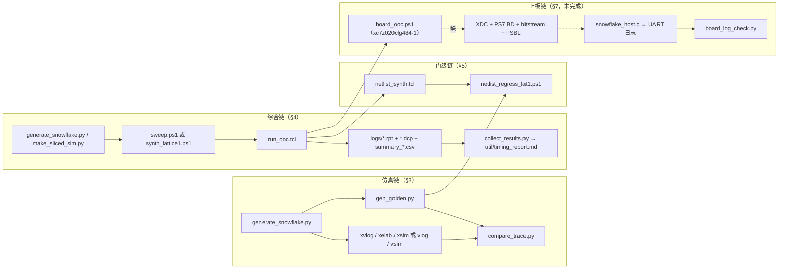
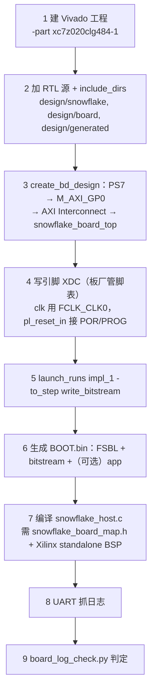

# Snowflake 解码器 · 工程操作手册（跑通 / 综合 / 门级 / 上板）

> 配套文档：架构与原理见 [Snowflake解码器技术文档.md](Snowflake解码器技术文档.md)。本手册只讲**怎么跑**：命令行、脚本、参数、产物落点、失败时看哪里。
>
> **现状一句话**：仿真（RTL + 门级）与综合/实现**全流程可跑**；**上板链路缺最后一段**——仓库里没有引脚约束、没有 PS7 block design、没有 `write_bitstream`、也没有可执行的烧写脚本。板厂资料到手之前，能做的到"板级顶层的 OOC 实现 + 板级通路仿真"为止，详见 §7。
>
> **本手册生成时未改动任何代码或脚本。** 所有命令行都取自脚本自身的使用说明（标注 `文件:行号`），不是推测。表内路径为 Windows；本仓库脚本按 Windows + Git-Bash 混用写过，PowerShell 脚本请用 `powershell -NoProfile -ExecutionPolicy Bypass -File ...` 调用。
>
> **术语**（*注：OOC = out-of-context 综合，不带顶层系统单独综合一个模块；DCP = Vivado checkpoint；XDC = 时序/引脚约束文件；FSBL = First Stage Boot Loader，Zynq 上加载 bitstream 之前必须先跑的一段初始化软件*）首次出现处就地解释，完整表在 §9。

---

## 目录

- [§0 五分钟速查](#0-五分钟速查)
- [§1 环境准备](#1-环境准备)
- [§2 第一步永远是"生成表"](#2-第一步永远是生成表)
- [§3 RTL 仿真与逐行回归](#3-rtl-仿真与逐行回归)
- [§4 综合与实现](#4-综合与实现)
- [§5 门级（综合后网表）回归](#5-门级综合后网表回归)
- [§6 Helios 基线对照口径](#6-helios-基线对照口径)
- [§7 上板：已完成的部分与缺失的部分](#7-上板已完成的部分与缺失的部分)
- [§8 故障排查索引](#8-故障排查索引)
- [§9 术语表](#9-术语表)

---

## §0 五分钟速查

```bat
:: (0) 一次性：确认 Vivado 与器件可用
cd /d D:\ycz\doc\deepseek_workzone\decoder\fpga_flow
D:\ycz\vivado\Vivado\2020.2\bin\vivado.bat -mode batch -source probe4.tcl -nojournal -nolog

:: (1) 一条命令跑完"生成图 → 黄金轨迹 → xsim → 逐行比对"
cd /d D:\ycz\doc\deepseek_workzone\decoder\snowflake_sim\run
regress.bat surface 3
regress.bat surface 5 1:1

:: (2) 不占 Vivado 许可的并行回归（ModelSim）
cd /d D:\ycz\doc\deepseek_workzone\decoder
powershell -NoProfile -ExecutionPolicy Bypass -File fpga_flow\msim_regress.ps1 -Code rep -D 3

:: (3) 综合 + 实现（队列）：任务写在 jobs*.txt，串行跑
powershell -NoProfile -ExecutionPolicy Bypass -File fpga_flow\sweep.ps1 -JobsFile jobs_m3_synth.txt -Mode synth -DryRun
powershell -NoProfile -ExecutionPolicy Bypass -File fpga_flow\sweep.ps1 -JobsFile jobs_m3_synth.txt -Mode synth

:: (4) 单条共享晶格（lat1，板级顶层用的形态）综合
powershell -NoProfile -ExecutionPolicy Bypass -File fpga_flow\synth_lattice1.ps1 -Code surface -D 3 -Slices 2

:: (5) 汇总进报告用的规范化表
python fpga_flow\collect_results.py

:: (6) 在 GUI 里看布线与时序
fpga_flow\open_gui.bat rep_d3_2to1_xcvu9p
```

各条命令展开后的调用链：



---

## §1 环境准备

### 1.1 工具与绝对路径（换机器必须改的地方）

| 工具 | 版本 | 硬编码位置 | 备注 |
|---|---|---|---|
| Vivado | **2020.2** | `snowflake_sim/run/run_core.bat:17` 等 8 个 `.bat` 的 `set VIVADO_BIN=D:\ycz\vivado\Vivado\2020.2\bin`；`fpga_flow/sweep.ps1:40`；`fpga_flow/run_queue.ps1:21`；`fpga_flow/run_helios_scale.ps1:24`；`fpga_flow/xsim_rtl_diag.ps1:25` | 换机器逐处改；没有集中的 env 文件 |
| ModelSim（Quartus 自带 ASE） | win32aloem | `fpga_flow/msim_regress.ps1:29`、`msim_regress_ctx.ps1:22`、`msim_regress_lat.ps1:25`、`msim_regress_lat1.ps1`、`msim_regress_board.ps1:38` 的 `$Bin = 'D:\quartus\modelsim\modelsim_ase\win32aloem'` | 只是 Vivado 许可被占用时的并行通道（§3.4） |
| Python | 3.11（本机 `D:\ycz\py311`） | 命令行直接 `python` | 需要 localuf 的依赖，见 §1.2 |
| 仓库根 | — | `fpga_flow/sweep.ps1:38-39` 写死绝对路径；其余多数脚本用 `$PSScriptRoot` 推导（如 `synth_lattice1.ps1:74-76`、`msim_regress.ps1:25-27`） | **`sweep.ps1` 与 `run_queue.ps1` 是移动目录后最先坏掉的两个** |

Vivado 任务队列的调用形态（`sweep.ps1:204`，一次只起一个进程）：

```
cmd /c "vivado.bat -mode batch -source fpga_flow\run_ooc.tcl -nojournal -nolog" > <log> 2>&1
```

### 1.2 Python 依赖与 localuf 位置

生成器与黄金轨迹脚本都直接 `import localuf`。查找方式写死在 `generate_snowflake.py:29-39`：只尝试两个相对路径——`build_scripts/../../../localuf-main/localuf-main` 与 `../../localuf-main/localuf-main`。因此**目录层级不能随便挪**：`localuf-main/localuf-main` 必须是工作区 `decoder/` 的直接子目录（当前满足）。找不到时 `LOCALUF` 为 `None`，随后 `import localuf` 直接失败。

依赖清单见 `localuf-main/localuf-main/environment.yml`：`numpy / scipy / pandas / statsmodels / networkx / matplotlib` + `pip: pymatching, stim`。`gen_golden.py`、`compare_schedules.py` 需要 `stim`；纯 `compare_trace.py` 是纯文本比对，不依赖 localuf。

自检一条命令：

```bat
cd /d D:\ycz\doc\deepseek_workzone\decoder\Helios_scalable_QEC-main\Helios_scalable_QEC-main\build_scripts
python -c "import sys,os;sys.path.insert(0,os.path.abspath('../../../localuf-main/localuf-main'));import localuf;print('localuf OK')"
```

### 1.3 器件与许可

本机安装的器件（权威探针记录在 `fpga_flow/probe4_log.txt`，`optimization_report.md` §1.1）：`xcvu9p-flga2104-2L-e`（VU9P/VCU118，**论文器件 VCU129 的 `xcvu29p` 未安装，用它替代**）、`xczu7ev-ffvc1156-2-e`（ZCU106，Helios 官方板）、`xczu19eg`、`xcku040`、`xc7z020clg484-1`（Z-7020，上板目标）、`xc7a100t`。

想复核一遍（含许可状态）：

```bat
vivado.bat -mode batch -source fpga_flow\probe4.tcl -nojournal -nolog
```

*探针脚本的选择有讲究：`optimization_report.md` §1.1 明确把 `probe4` 称作"权威探针，已去掉会吞错误的 `-quiet`"，而 `probe_license.tcl:26` 里的 `synth_design` 仍带 `-quiet`。要拿器件可用性当结论时用前者，别用后者——`-quiet` 会把"这个 part 其实没装"和"综合失败"混成同一句没有。*

### 1.4 三条环境红线

1. **`.bat` 必须纯 ASCII**。`regress.bat:10`、`run_core.bat` 等文件头都写着 "ASCII only on purpose (cmd.exe mangles non-ASCII .bat files)"。往里加中文注释会让 cmd 按本地码页把注释当命令执行，表现为死循环（`snowflake_sim/README_snowflake.md:156`）。
2. **Python 输出走 UTF-8**。`regress.bat:18` 显式 `set PYTHONIOENCODING=utf-8`。本机控制台默认码页是 GBK，任何 Python 脚本往 stdout 打印中文都可能抛 `UnicodeEncodeError`；读本项目 `.md` 一律用 `encoding='utf-8'`。历史事故留档在 `fpga_flow/evidence/INCIDENT_generate_snowflake_GBK_corruption.py.txt`（生成器被 GBK 往返二次编码后的样子，651 行）。
3. **一次只跑一个 Vivado 进程**。见 §2.4，这是物理约束而不是偏好。

---

## §2 第一步永远是"生成表"

RTL 不含任何硬编码码距，图结构全部来自生成物（原理见技术文档 §6.1）。**跑任何仿真/综合之前，先把表生成对。**

### 2.1 四张表与四个生成器

| 你要做什么 | 必须生成 | 生成器与用法 | 输出 |
|---|---|---|---|
| 任何构建（基础） | 解码图表 | `python build_scripts\generate_snowflake.py --code surface --d 5 [--dirs used] [--noise circuit-level] [--slices N]` | `design/generated/snowflake_graph_<code>_d<d>.svh` + **同名覆盖写 `snowflake_graph.svh`**（`generate_snowflake.py:491-495`）+ `<name>_part.json`（分区/跨区边清单，`:497-498`） |
| `SNOW_SLICED` / `SNOW_SERIAL`（切片缝） | 缝常量表 | `python fpga_flow\make_sliced_sim.py --code surface --d 5 --slices 2 [--dirs used] [--force-regen]`（`make_sliced_sim.py:322-326`） | `design/generated/snowflake_seam.svh`（同样写进 RTL 树！） |
| `SNOW_LAT` / `SNOW_LATTICE`（共享晶格） | 晶格表 | `python fpga_flow\make_lattice_sim.py --code surface --d 5 --slices 2 [--dirs all] [--pad K] [--noise ...]`（`make_lattice_sim.py:1477-1491`） | `design/generated/snowflake_lattice.svh`（内部再 `include "snowflake_graph.svh"`） |
| 上板（PS 侧软件） | 布局 JSON + 软件头 | `python fpga_flow\make_board_map.py --code rotated --d 3 [--dirs all] [--noise ...] [--maxrec 128]`（`make_board_map.py:92-99`） | `fpga_flow/board/board_map.json` + `design/generated/snowflake_board_map.h`，并**自校验与图头一致** |

多上下文版 PE 是**代码生成**而非表：`python fpga_flow\make_pearray_ctx.py` → 重写 `design/snowflake/snowflake_pe_ctx.sv` 等（该文件头 `:2` 写着 `GENERATED ... do not edit by hand`）；两上下文扁平核原型同理 `python fpga_flow\make_ctx2.py`。

### 2.2 别名快照：最容易出错的一处

所有 RTL 都 `` `include "../generated/snowflake_graph.svh" ``，而该文件只是**最后一次生成的复制品**。三个后果：

- 换码型/码距必须重跑生成器，否则你以为在跑 surface d5，实际在跑上一次留下的 rep d3；
- **同一棵树里不能同时编译两个配置**（`sweep.ps1:11-12` 的注释直说：并发的两个 Vivado 会互相破坏对方的图）；
- 本工作区当前那份别名文件是**旧格式**：无 `// SNOW_GRAPH_FORMAT` 标记、缺 `SNOW_PE_STW` 与 `SNOW_PTR_DOWN_MASK`（带名字的文件才有，见 `snowflake_graph_surface_d3.svh:31-32`）。凡涉及 `SNOW_LAT` 的构建，先重新生成，否则 parse 期就缺符号。

**动手前的一致性自检**（推荐每次都跑）：

```bat
python fpga_flow\check_lattice_geometry.py          # d3/d5/d7/d21 + rep：几何前提
python fpga_flow\check_lattice_slots.py surface 5 2 # 槽位编号
python fpga_flow\check_slice_ports.py surface 5 2   # 切片端口映射自洽
python fpga_flow\check_circuit_level_geometry.py    # 电路级噪声图与晶格几何是否兼容
```

`synth_lattice1.ps1` 把这件事做成了强制：它自带 VERIFY 步骤，**磁盘上的晶格表不属于请求的配置就拒绝综合**（头注释 `:11-12` "The same VERIFY step is kept and is still not optional"）。而 `sweep.ps1` 只在缺文件时生成，不会校验已存在的表——这是两条路径的重要差别，别指望后者替你把关。

### 2.3 钉住（pinning）：为什么产物落在 `fpga_flow/graphs/`

`sweep.ps1` 的应对办法是给每个作业准备一份**私有副本**并在 Vivado 里再复制回别名位置：

- 图：`graphs/<code>_d<d>.svh`（缺则现场调生成器再复制，`sweep.ps1:131-137`）；
- 缝：`graphs/seam_<code>_d<d>_s<N>.svh`（`sweep.ps1:146-158`，仅当 defs 含 `SNOW_SLICED|SNOW_SERIAL`）；
- 交给 Vivado：`run_ooc.tcl:43-49` 用 `FLOW_GRAPH` 复制到 `design/generated/snowflake_graph.svh` 并打印 `FLOW_GRAPH_PINNED`，`run_ooc.tcl:55-61` 用 `FLOW_SEAM` 同法处理 `snowflake_seam.svh`。

`fpga_flow/graphs/` 现有 29 份钉住的表（含 `_circuit-level` / `_phenomenological` / `_used` 变体）。**手工跑生成器之后，记得这个目录里可能已经存着旧副本，两者不一致时以你钉住的那份为准。**

### 2.4 生成物会写进 RTL 树

`generate_snowflake.py`、`make_sliced_sim.py`、`make_lattice_sim.py`、`make_pearray_ctx.py`、`make_ctx2.py` 都会把文件写进 `H/design/generated/` 或 `H/design/snowflake/`。**"看着像只读"的 Python 运行会脏化工作区**——这是本项目操作纪律里最容易违反的一条。要纯计算请用 `python -B`（不写 `.pyc`）并确认脚本只读。

---

## §3 RTL 仿真与逐行回归

两条等价通道，判据同一个（`compare_trace.py` 打印的 `REGRESS_VERDICT PASS`）：

| | xsim（Vivado） | ModelSim |
|---|---|---|
| 入口 | `snowflake_sim/run/regress.bat` 与 6 个 `run_*.bat` | `fpga_flow/msim_regress*.ps1`（5 个） |
| 工作目录 | 直接在 `H/` 源码上编译 | 私有副本 `fpga_flow/msim*`（§3.4） |
| 许可 | 占 Vivado | 不占，**可在综合扫描进行时并行跑** |
| 适合 | 单点快速验证、看波形 GUI | 批量开关组合、回归 |

### 3.1 一条命令跑完整链：`regress.bat`

```bat
cd /d D:\ycz\doc\deepseek_workzone\decoder\snowflake_sim\run
regress.bat <rep|surface> <d> [1:1]
```

四步展开（`regress.bat:22-38`）：① `pushd build_scripts && python generate_snowflake.py --code %1 --d %2`；② `python ..\ref\gen_golden.py --code %1 --d %2 --schedule %SCHED% --out ..\ref\golden_tmp.txt`；③ `call run_core.bat %SCHEDARG%`；④ `python ..\ref\compare_trace.py ..\ref\golden_tmp.txt rtl_trace.txt`。任何一步 `errorlevel 1` 就跳到 `:fail` 退出 1。

**黄金与 RTL 必须同调度、同图**——第 ① 步生成的图就是第 ② ③ 步的依据，中途别再手工生成别的配置。

### 3.2 单形态仿真：6 个 `run_*.bat`

| 脚本 | 用法 | 编译的 DUT / TB | 产物 |
|---|---|---|---|
| `run_core.bat` | `run_core.bat` 或 `run_core.bat 1:1` | `snowflake_core.sv` + `tb_snowflake_core.sv` | `rtl_trace.txt`、`tb_snow.wdb` |
| `run_pearray.bat` | 同上形态 | `snowflake_pe_array.sv` + `tb_snowflake_pe_array.sv` | `rtl_trace.txt`、`tb_pearr.wdb` |
| `run_pearray_ctx.bat` | 多上下文阵列 | `*_ctx.sv` 三件套 | `rtl_trace_ctx0.txt` / `_ctx1.txt` |
| `run_ctx2.bat` | 两上下文扁平核 | `snowflake_core_ctx2.sv` | `tb_snow_ctx2.wdb` |
| `run_wrapper.bat` | 字节流接口（连带编译 Helios 的 `design/generics/fifo_fwft.v` 与 `design/channels/serdes.sv`；`parameters.sv` 由 wrapper 自己 include 带进来） | `snowflake_core.sv` + `snowflake_wrapper.sv` + `tb_snowflake_wrapper.sv` | `wrap_log.txt`、`tb_snow_wrap.wdb` |
| `run_netlist.bat` | 门级 | 综合后网表 | `netlist_trace.txt`（见 §5） |

内部三条命令（以 `run_core.bat:29-40` 为准）：

```bat
xvlog.bat -sv %DEFS% %SNOW_DEFS% <DUT.sv> <TB.sv>
xelab.bat tb_snowflake_core -s tb_snow -debug typical
xsim.bat  tb_snow -t sim_run.tcl
```

要点：

- `1:1` 参数会翻译成 `-d SNOW_ONE_ONE`（`:23`），并把仿真标签切成 `1to1`；
- **额外宏一律通过环境变量 `SNOW_DEFS` 传入**，形如 `set SNOW_DEFS=-d SNOW_BUSYREG`，多个用 `-d A -d B`；
- `xelab` 必须带 `-timescale 1ns/1ps` 才能编译 Helios 的 `fifo_fwft.v`（全设计 timescale 统一，`README_snowflake.md:160`）；
- 每次先 `rmdir /s /q xsim.dir` 并删旧 `rtl_trace.txt`，防止比对到上一轮的产物。

停顿注入（额外延迟档位）走同一入口，但**只能用标记宏**：

```bat
cmd /c "set ""SNOW_DEFS=-d SNOW_STALL"" && snowflake_sim\run\run_pearray_ctx.bat rep 3"
cmd /c "set ""SNOW_DEFS=-d SNOW_STALL -d SNOW_STALL_D40"" && ..."   :: D10/D20/D40/D60/D100
```

原因记录在 `optimization_report.md` §8 复现命令 1b：`xvlog.bat` 会把 `-d NAME=value` 的等号吃掉，所以延迟数值不能当参数传，只能做成一组档位宏。

### 3.3 手工跑（脚本不满足需求时）

以 PE 阵列为例，最小命令集：

```bat
set REPO=D:\ycz\doc\deepseek_workzone\decoder\Helios_scalable_QEC-main\Helios_scalable_QEC-main
set XB=D:\ycz\vivado\Vivado\2020.2\bin
cd /d D:\ycz\doc\deepseek_workzone\decoder\snowflake_sim\run
"%XB%\xvlog.bat" -sv -d SNOW_SLICED -d SNOW_SERIAL "%REPO%\design\snowflake\snowflake_edge.sv" "%REPO%\design\snowflake\snowflake_pe.sv" "%REPO%\design\snowflake\snowflake_pe_array.sv" "%REPO%\test_benches\snowflake\tb_snowflake_pe_array.sv"
"%XB%\xelab.bat" tb_snowflake_pe_array -s tb_pearr -debug typical
"%XB%\xsim.bat" tb_pearr -t sim_run.tcl
python ..\ref\compare_trace.py ..\ref\golden_tmp.txt rtl_trace.txt
```

include 靠 RTL 里的相对路径（`../generated/...`）解析，因此**从 `H/design/snowflake/` 的相对位置编译**才成立；把源文件拷到别处时要么保持相对目录，要么补 `-i <dir>`。Vivado 侧的非工程流程同理需要 `set_property include_dirs {design/generated design/snowflake}`——`run_ooc.tcl:72-84` 的注释解释了为什么（`read_verilog` 在 2020.2 没有 `-include_dirs`，不设就报 "cannot open include file snowflake_graph.svh"，随后满屏 "value of X depends on itself"）。

### 3.4 ModelSim 回归：五个脚本与它们的私有副本

| 脚本 | 覆盖形态 | 主要参数（来自各自 `param()`） |
|---|---|---|
| `msim_regress.ps1` | PE 阵列 | `-Code -D -Slices -Defs -Dirs -Pattern(std/seam)` |
| `msim_regress_ctx.ps1` | 多上下文阵列 | `-Code -D -Defs -Dirs` |
| `msim_regress_lat.ps1` | 共享晶格（复制版 lat） | 同上 |
| `msim_regress_lat1.ps1` | 共享晶格（合并版 lat1） | `-Code -D -Slices -Dirs -Pattern -ExtraDefs -Noise` |
| `msim_regress_board.ps1` | 板级通路（假 PS 走寄存器） | `-Code -D -Slices -Dirs -Pattern -Noise -NoRebuildGolden -TagSuffix` |

调用形态：

```bat
powershell -NoProfile -ExecutionPolicy Bypass -File fpga_flow\msim_regress.ps1 -Code rep -D 3 -Defs SNOW_BUSYREG,SNOW_MINTREE
```

它做的七步（`msim_regress.ps1:30-100`，值得看懂，因为 `lat1/board` 变体是同构的）：① 把 `design/snowflake/{edge,pe,pe_array}.sv` 与 TB 拷进 `fpga_flow/msim/`；② 在 `build_scripts` 里跑生成器（带 `-slices` 当 defs 含 `SNOW_SLICED`）；③ 把命名图复制成 `msim/design/generated/snowflake_graph.svh`，需要时同样复制 `snowflake_seam.svh`；④ `gen_golden.py` 产 `golden_<tag>.txt`；⑤ `vlib/vlog/vsim -c -do "run -all; quit -f"` 编译运行，日志进 `fpga_flow/logs/msim_<tag>.log`；⑥ 把 `rtl_trace.txt` 改名成 `rtl_trace_<tag>.txt`（**避免多轮互相覆盖**）；⑦ `compare_trace.py` 取 `REGRESS_VERDICT`，PASS 退出 0、否则 1。

tag 组成 = `<code>_d<D>` + `_`+各 defs + `_seam` + `_used`——**每个改变结果的维度都进 tag**，这条规则在 §4.3 会以更严重的形式复发。

### 3.5 判定与减方向集

```bat
python snowflake_sim\ref\compare_trace.py <golden> <rtl_trace> [--ptrmap "0,1,2,..."]
```

- 判据三件事：行数相同、逐行相同、提交事件集合相同（技术文档 §9.2）。
- 用 `--dirs used` 时，RTL 打印的指针用**缩减后的方向编号**，黄金用 localuf 的完整 12 方向，必须加 `--ptrmap`。映射由脚本算，**不要手写**：

```bat
for /f %m in ('python fpga_flow\dirs_ptrmap.py --code surface --d 5 --dirs used') do @set PMAP=%m
python snowflake_sim\ref\compare_trace.py golden.txt rtl_trace.txt --ptrmap %PMAP%
```

### 3.6 看波形

```bat
cd /d D:\ycz\doc\deepseek_workzone\decoder\snowflake_sim\run
run_gui.bat                 :: 打开 xsim GUI，gui_wave.tcl 自动加载约 20 组信号并 run
```

或在 Vivado GUI 的 Tcl 控制台里 `source open_wave.tcl` 打开已存的 `tb_snow.wdb` / `tb_snow_wrap.wdb`。推荐观察信号（`README_snowflake.md:113`）：`dut/obs_active`、`dut/obs_defect`、`dut/obs_growth` + `dut/obs_ecorr`、`dut/dbg_stage` + `dut/dbg_step`、`commit_onehot`。

### 3.7 失败时的诊断顺序

1. `diff_trace_blocks.py`——按 `T` 行对齐后，打印第一个内容不同的块里第一条不同的状态行（比 `compare_trace.py` 的首次不匹配更直观）；
2. `xsim_rtl_diag.ps1 -Code rep -D 3`——带诊断信号的 xsim 复跑（产物在 `fpga_flow/xsim_rtl_diag/`）；
3. `check_pb_bnd.py <golden...>`——回答"`push` 里的 `!IS_BND` 项到底重不重要"这类语义取证；
4. `dbg_ctx2*.py`、`dbg_parrctx.py`——当年调多上下文时留下的**一次性**切片脚本（26/17/24/26/9/8 行，读 `golden_tmp.txt` 与 `rtl_trace_ctx*.txt` 打点对比）。它们不是常规工具，只作历史参考；
5. 若"状态行全对、提交事件 0/N"，直接看技术文档 §6.8 的第二条红线（全局组合归约的采样相位错了会静默空跑）。

---

## §4 综合与实现

### 4.1 引擎只有一个：`run_ooc.tcl`

`fpga_flow/run_ooc.tcl` 是参数化的 OOC 流程，**所有输入都来自环境变量**（头注释 `:4-25`）：

| 变量 | 必需 | 取值 | 作用 |
|---|---|---|---|
| `FLOW_REPO` | ✔ | `H/` 绝对路径 | 源文件与生成物的根 |
| `FLOW_TOP` | ✔ | 如 `snowflake_core` / `snowflake_pe_array` / `snowflake_pe_array_lat1` / `snowflake_board_top` | 综合顶层 |
| `FLOW_PART` | ✔ | 如 `xcvu9p-flga2104-2L-e` | 器件 |
| `FLOW_PERIOD` | ✔ | ns | `create_clock` 周期 |
| `FLOW_TAG` | ✔ | 任意 | 一切产物文件名与 CSV 行名 |
| `FLOW_OUT` | ✔ | 目录 | 产物目录（约定 `fpga_flow/logs`） |
| `FLOW_SRCS` | | `;` 分隔 | 默认 `design/snowflake/snowflake_core.sv`；跑阵列/晶格必须列全 |
| `FLOW_DEFS` | | `;` 分隔宏 | 例 `SNOW_SLICED;SNOW_SERIAL` |
| `FLOW_GRAPH` / `FLOW_SEAM` | | 表文件路径 | 钉住图/缝（§2.3） |
| `FLOW_MODE` | | `impl`\|`synth` | `impl` 走完 place+phys_opt+route；`synth` 只出 postsynth 报告 |
| `FLOW_FLATTEN` | | `none`\|`full`\|`rebuilt` | `synth_design -flatten_hierarchy`，唯一能绕开 elaborate 内存墙的旋钮（§4.5） |
| `FLOW_GENERICS` | | `NAME=value;...` | 顶层参数覆盖（如 `NCTX=8`）。**必须 `name=value` 形式**：`"NAME value"` 只生效第一对（`:88-95`） |
| `FLOW_KEEP_HIER` | | `1` | 给 `snowflake_pe*`/`snowflake_edge*` 设 `KEEP_HIERARCHY`，阻止 `opt_design` 抹平模块边界（`:112-116`） |
| `FLOW_PBLOCK=<k>` | | 整数 | 把阵列切成 k 条全高竖按时钟区域带并钉位——**测缝的代价**（`:154-198`） |
| `FLOW_PBLOCK_ONE=<n>` | | 整数 | 把所有 PE/edge 关进一个 n 区域的紧凑块——**测"小设计摊在大芯片上"是否就是布线延迟主因**（`:117-153`） |
| `FLOW_EXTRA_CLK` | | ns | 顶层若有 `clk2` 时的第二个时钟约束 |

产物（`run_ooc.tcl:99-215`）：`ooc_<tag>.xdc`（自动生成的 OOC 约束）、`util_synth_/utilhier_synth_/util_route_/utilhier_route_.rpt`、`timing_<tag>.rpt`（summary）、`timing_paths_<tag>.rpt`（带 `-input_pins`，看关键路径落点用这个）、`logic_levels_<tag>.rpt`、`power_/drc_/clocks_<tag>.rpt`（`catch` 包裹，可能缺）、`postroute_<tag>.dcp` 或 `postsynth_<tag>.dcp`，以及最后一行机器可读的：

```
FLOW_RESULT tag=... top=... part=... period=... mode=... wns=... levels=... min_period=... fmax_mhz=... lut=... ff=... lutram=... bram=... uram=... dsp=...
FLOW_DONE <tag>
```

*器件家族坑：* 行标签依赖家族——UltraScale 写 `CLB LUTs/CLB Registers`，7 系列（含上板用的 Z-7020）写 `Slice LUTs/Slice Registers` 且没有 URAM。`run_ooc.tcl:234-248` 的 `util_any` 做双名回退；注释记录了这个 bug 曾让首批板载跑输出 `lut=NA ff=NA`。

### 4.2 队列驱动：`sweep.ps1`

```bat
powershell -NoProfile -ExecutionPolicy Bypass -File fpga_flow\sweep.ps1 -JobsFile jobs.txt [-Mode impl|synth] [-Top snowflake_pe_array] [-Srcs "a.sv;b.sv"] [-ExtraDefs SNOW_MINTS] [-Graph <svh>] [-Seam <svh>] [-TagPrefix lat1_] [-Slices 3] [-Flatten rebuilt] [-Csv out.csv] [-SkipExisting] [-DryRun]
```

作业文件格式（`sweep.ps1:6-9`、解析在 `:58-71`）——**每行一个作业，空白分隔，`#` 起注释**：

```
<code> <d> <schedule> <part> <period_ns> [extra_defs] [generics]
```

例（`fpga_flow/jobs_m3_synth.txt` 全文）：

```
rep 3 2:1 xcvu9p-flga2104-2L-e 5.0 SNOW_M3LOC
rep 5 2:1 xcvu9p-flga2104-2L-e 5.0 SNOW_M3LOC
surface 3 2:1 xcvu9p-flga2104-2L-e 5.0 SNOW_M3LOC
```

第 6 字段是宏（`;`、`,` 或空白分隔），第 7 字段是顶层参数覆盖（`,` 分隔，因为行内不能有空格）。为什么要用文件传参而不是命令行：避开 shell 引号地狱（`:8-9` 明说）。

现成作业清单（`fpga_flow/jobs*.txt`，共 30 余份，都是一次性实验的固化）：`jobs_ablate_min.txt`、`jobs_ablate_vu9p.txt`、`jobs_busyreg_synth/impl.txt`、`jobs_mints_d37.txt`、`jobs_mints_busyreg.txt`、`jobs_pearray_synth/impl.txt`、`jobs_pearray_mintree.txt`、`jobs_pearray_noobs.txt`、`jobs_lattice_a.txt`、`jobs_lattice_b.txt`、`jobs_lattice1_*.txt`（按 code/d/slice 分）、`jobs_board_ooc.txt`、`jobs_zcu106.txt`、`jobs_netlist.txt`、`jobs_v2d_*.txt`、`jobs_lutram_probe.txt`、`jobs_dirsused_*.txt`、`jobs_fit_synth*.txt`、`jobs_d5_retry.txt`、`jobs_d7_synth.txt`、`jobs_period_confirm.txt`、`jobs_ctx2_area.txt`、`jobs_pearrctx_*.txt`、`jobs_seam_impl.txt`。**复用其中一份改两行，比自己起一条命令安全得多。**

`-DryRun` 只打印 tag 不起 Vivado——**每次动队列前先 DryRun 一遍**（`sweep.ps1:118`）。

### 4.3 tag 规则：这个项目栽过最多次的地方

`sweep.ps1:82-117` 拼 tag：`<TagPrefix><code>_d<d>_<2to1|1to1><由宏产生的后缀>_<partShort>`，然后**有条件追加**：

- `-Slices ≠ 2` → `_s<N>`（`:109`）；
- 顶层参数 → 逐个追加小写名（`:110-114`）；
- `-Flatten ≠ none` → `_f<mode>`（`:115`）；
- 周期 ≠ 5.0 → `_p<period>`（`:117`）；
- 宏后缀：先在 `vmap` 里查历史别名（`:86-89`，如 `SNOW_CTX1→nctx1`、`SNOW_PEARRAY→pearray`），查不到就取 `SNOW_` 之后、去符号、截 8 字符小写（`:96-99`）。

注释里三条血案都写在原地：`TagPrefix` 曾经声明在注释行里 → PowerShell 根本没绑定它，`-TagPrefix lat1_` 被静默收进 `$args`，合并版和复制版的行**字节相同**地互相覆盖（`:22-28`）；`_s<n>` 缺失 → n=2/3/5 扫描把 CSV 覆盖成只剩最后一行、前面的 log 直接丢（`:104-108`）；`_used` 缺失 → `--dirs used` 与 `all` 是两张不同的图，却能互相覆盖（同处 + `synth_lattice1.ps1:26-30`）。

**操作规则：任何会改变"配置身份"的新维度（宏、切片数、噪声模型、方向集、pad 因子、RTL 版本）必须进 tag。** `-Rev` 就是为此而设：RTL 本身变了但配置没变时，加 `-Rev v2` 让新行落在新 tag 上；否则 `SkipExisting` 会让重测**静默变成空操作**（`synth_lattice1.ps1:51-58` 记录的就是这次事故：`SNOW_PTR_DOWN_MASK` 修复后若不换 tag，重测什么都没跑）。

同类坑：PowerShell 变量名大小写不敏感。**参数绝不能用 `$Defs`**，因为脚本内部有局部 `$defs`，二者是同一个变量——第一版这样写，结果 `SNOW_LATTICE;SNOW_LAT` 被重复覆盖、marker 全丢，pblock 实验跑成了无约束基线、数字与基线逐位相同（`synth_lattice1.ps1:64-71`、`sweep.ps1:161-163`）。

### 4.4 单配置驱动：`synth_lattice.ps1` / `synth_lattice1.ps1` / `board_ooc.ps1`

| 脚本 | 顶层 | 关键参数 | 特点 |
|---|---|---|---|
| `synth_lattice.ps1` | `snowflake_pe_array_lat` | `-Code -D -Slices -Dirs -Part -Period -Mode` | 复制版晶格（每上下文一套数据通路） |
| `synth_lattice1.ps1` | `snowflake_pe_array_lat1` | 上述 + `-Pad K -Noise -Flatten -Rev -ExtraDefs`，tag 前缀 `lat1_` | **板级顶层实际用的形态**；自带 VERIFY；`-Pad 1` 是默认且必须与改动前的表逐字节相同（折叠实验红线） |
| `board_ooc.ps1` | `snowflake_board_top` | `-Code -D -Slices -Dirs -Noise -Part xc7z020clg484-1 -Period -Mode -Csv -Rev` | 带 PS 侧外围（host_regs/trace_capture/reset_sync）的实现级测量，写 `summary_board.csv` |

```bat
powershell -NoProfile -ExecutionPolicy Bypass -File fpga_flow\synth_lattice1.ps1 -Code rotated -D 5 -Slices 2 -Part xc7z020clg484-1 -Period 10.0 -Mode impl
powershell -NoProfile -ExecutionPolicy Bypass -File fpga_flow\board_ooc.ps1 -Code rotated -D 3 -Slices 2 -Part xc7z020clg484-1 -Period 20.0 -Mode impl
```

`-ExtraDefs` 追加在阵列自带的 `SNOW_LATTICE;SNOW_LAT` 之后（`;` 或 `,` 分隔），布局 marker `SNOW_KEEPHIER` / `SNOW_PB<n>` / `SNOW_PBONE<n>` 就在这里传，由 `sweep.ps1:191-195` 翻成 `FLOW_*`。

### 4.5 elaborate 内存墙：跑 d7 之前先看这一节

`synth_lattice1.ps1:46-50` 把这件事量化了：`snowflake_pe.sv` 若 include 生成表，则 NSLOT+ESLOT 个实例**每个**都要 elaborate 一遍，峰值约 25–38 MB/实例：rotated d3（58 实例）1.45 GB、rotated d5（219）5.45 GB、surface d5（273）**10.4 GB**、rotated d7（548）**13.2 GB 以上**——15.9 GB 的机器构建不出来。

已落地的缓解：把 `SNOW_PE_STW` 移进图表、`snowflake_pe.sv` 不再 include 晶格表（技术文档 §6.7 的红线）；`-Flatten rebuilt/full` 作为最后的旋钮；以及**上板器件 Z-7020 的跑法要按板卡内存预算重新估**。跑 d7 级别前先 `-DryRun` 加一次小规模确认量级。

### 4.6 读结果

| 汇总工具 | 命令 | 产出 |
|---|---|---|
| `collect_results.py` | `python fpga_flow\collect_results.py` | 读 `summary_impl.csv`/`summary_synth.csv` + `cycles.csv` → 重写 `util_report.md`（M1 面积）、`timing_report.md`（M2 时序）、`results.csv`（规范化扁表）。三个文件头部都标了"自动生成" |
| `collect_cycles.py` | `python fpga_flow\collect_cycles.py` | 生成各配置黄金轨迹并统计每轮拍数 → `cycles.csv`（列：`tag,rounds,cycles,drop,grow,grow_half,merge,cycles_per_round,merge_per_round,cycles_with_split_merge,split_factor`） |
| `cycles_report.py` | `python fpga_flow\cycles_report.py` | P0b：`n` 轴周期斜率（从 ModelSim 日志的 `[cyc] round=.. cycles=..` 行拟合） |
| GUI 查看 | `fpga_flow\open_gui.bat [<tag>]` | 不带 tag 就取 `logs/` 里最新的 `postroute_*.dcp`；等价于 `vivado -mode gui -source open_impl_gui.tcl [-tclargs <tag>]`（`open_impl_gui.tcl:5-15`），并另存 `gui_<tag>_*.rpt` |

GUI 里常配的 Tcl（`optimization_report.md` §1.2）：`report_timing -max_paths 20 -input_pins`、`select_objects [get_cells <name>]`、`show_schematic [get_cells <name>]`。

> ⚠️ **CSV 的小数资源列不可信。** `run_ooc.tcl:219-231` 的 `util_row` 取匹配行里第一个"严格整数"token，因此 `| Block RAM Tile | 7.5 | 0 | 140 | 5.36 |` 会读成 `0`（那是"增量"列）。实测对照：`logs/util_route_board_rotated_d3_2to1_lattice_lat_r2_xc7z020clg484_p20.rpt:96` 写 `7.5`，同一 tag 在 `summary_board.csv` 里 `bram=0`。LUT/FF/级数/WNS/f_max 不受影响（它们的"使用量"列本来就是整数）。凡要用 BRAM 数字，回到 `.rpt` 读。

**周期外推法**："达成周期 = 约束周期 − WNS" 必须用收紧约束复跑来验证，不能只信一次。已验证样本：surface d3 在 5.0 ns 约束下 WNS −0.940 ⇒ 预测 6.94 ns；改 7.0 ns 复跑 WNS +0.057 ⇒ 实测 6.943 ns，吻合到 0.003 ns（`optimization_report.md` §1.4）。

### 4.7 一次性电池脚本（battery 家族）

`battery_2pass.ps1`、`battery_lat1.ps1`、`battery_lat1_n.ps1`、`battery_lat1_cycles.ps1`、`battery_netlist_lat1.ps1`、`busyreg_battery.ps1`、`d7_battery.ps1`、`dirs_ablation.ps1`、`p2_battery.ps1`、`pad_fold_battery.ps1`、`pbone_battery.ps1`、`z7020_battery.ps1`、`z7020_extra_battery.ps1`、`reset_contract_sweep.ps1`、`chain_lat1_synth*.ps1`、`run_after_chain*.ps1`、`run_after_noobs.ps1`、`run_lattice1_surface_d5.ps1`、`run_queue.ps1`——都是**某次证据采集的固化脚本**，参数写死、tag 写死、输出追加进既定 CSV。用法：读它的头注释确认它针对的配置，再照抄；不要把它们当通用工具，尤其注意 `run_queue.ps1:18` 的 `-Steps` 是按名字重放历史队列（`fit11,ablate,period,zcu106,netlist,helios`）。它们共同的隐含约定是"串行 + 每行自己的 tag"，动它们时 §4.3 的规则一律适用。

---

## §5 门级（综合后网表）回归

目的：证明**综合没有改变语义**（x 传播、位宽截断、don't-care 支路）。

```bat
:: 一键（推荐）：综合 → 写 funcsim 网表 → 仿真 → 逐行比对
powershell -NoProfile -ExecutionPolicy Bypass -File fpga_flow\netlist_regress_lat1.ps1 -Code rep -D 3 -Slices 2
powershell -NoProfile -ExecutionPolicy Bypass -File fpga_flow\netlist_regress_lat1.ps1 -Code rotated -D 5 -Noise circuit-level -Probe

:: 手工两步
powershell -NoProfile -ExecutionPolicy Bypass -File fpga_flow\synth_lattice1.ps1 -Code rep -D 3 -Mode synth     :: 产 logs\netlist_*.v
snowflake_sim\run\run_netlist.bat ..\..\fpga_flow\logs\netlist_rep_d3_2to1.v rep_d3_2to1
python snowflake_sim\ref\compare_trace.py snowflake_sim\ref\golden_tmp.txt snowflake_sim\run\netlist_trace.txt
```

`netlist_synth.tcl:1-8` 说明它复用与 `run_ooc.tcl` **同一套 `FLOW_*` 环境变量**，只是最后 `write_verilog -mode funcsim` 而不是做实现。

**两个必踩的坑**（`optimization_report.md` §8 复现命令 1i，原文标了 ⚠️）：

1. 网表仿真必须活过 `glbl.GSR` 的 100 ns 窗口。TB 在 `` `ifdef SNOW_NETLIST `` 下写 `while (glbl.GSR !== 1'b0) @(posedge clk);`（`tb_snowflake_core.sv:103-111`）；少了它就是"第一个 `start` 被吞、FSM 永远停在 `ST_IDLE`、20 ms 看门狗、空轨迹"——**症状是像跑通了但什么都没有**。门级流程必须编译 `glbl.v`。
2. TB 的 `SNOW_NETLIST` 探针（打印 stage/phase/CE 等）只在门级运行里编译；网表里没有 `phase` 这类内部信号，读它会报 `VRFC 10-2991`。端口版探针默认开，要读内部信号得显式加 `-Probe`。

取证工具：

```bat
python fpga_flow\netlist_qmap.py <netlist.v> <net> [<net> ...]
python fpga_flow\netlist_qmap.py <netlist.v> --multi     :: 列出所有多驱动 net
```

（"某根线谁在驱动、驱动是死是活"，用于 `logs/netlist_lat1_*_netlist.v`，最大的有 2.7 MB。）

黄金与 PASS 证据在 `fpga_flow/evidence/`（88 个文件，命名如 `golden_lat1_*_netlist.txt`、`PASS_lat1_rep_d3_s2_netlist_rtl.txt`）。

---

## §6 Helios 基线对照口径

要拿"和论文同口径"的 Helios 面积/时序做对照时：

```bat
powershell -NoProfile -ExecutionPolicy Bypass -File fpga_flow\run_helios_scale.ps1                      :: 默认 -Points '7:6;9:8'
powershell ... -File fpga_flow\run_helios_scale.ps1 -Points '7:6;9:8' -IncludeBase
vivado.bat -mode batch -source fpga_flow\synth_helios_baseline.tcl -nojournal -nolog
vivado.bat -mode batch -source fpga_flow\synth_helios_pe.tcl       -nojournal -nolog
```

三个必须知道的约定：

1. **绝不动上游仓库。** `run_helios_scale.ps1:12-14` 说明：阶段枚举缺失之类的补丁打在 `fpga_flow/helios_baseline/`（自己的副本，含 `design/` 与 `parameters/` 两棵树），码距参数是**每次运行前改副本里的默认值**，因为非工程流程没有干净的 Verilog 参数覆盖通道。上游仓库的 `parameters/parameters.sv:4-13` 只有旧 8 阶段名，而 `processing_unit.sv:197/471/479` 用的是 `STAGE_SPREAD_CLUSTER` 等新名（只存在于补丁副本 `fpga_flow/helios_baseline/parameters/parameters.sv:13`）——**从上游仓库直接起会 elaboration 失败**。
2. 泛型参数必须 `name=value`，用空格分隔多个：`HELIOS_PE_GENERICS='ADDRESS_WIDTH=9 DISTANCE_WIDTH=4 MEASUREMENT_ROUNDS=5 DIRECT_CHANNEL_COUNT=1'`；写成 `"NAME value"` 不会生效（`optimization_report.md` §8 复现命令 2b）。去掉 direct channel 即论文口径（`DIRECT_CHANNEL_COUNT=1`）。
3. 口径对照结果（`optimization_report.md` §0/§2.4）：Helios 论文 194.5 LUT/PE，单 PE 综合 216/166 vs 论文 200/155（+8%/+7%），差异口径已对齐。多 FPGA 版的上游工程脚本（`build_scripts/tcl_script_hub_full_gpio.tcl`、`templates/tcl_script_{root_hub,leaf,wrapper}.tcl`）是 BD/工程创建的**参考样例**，与本项目的 Snowflake 无关。

---

## §7 上板：已完成的部分与缺失的部分

### 7.1 诚实的现状

| 环节 | 状态 | 证据/入口 |
|---|---|---|
| PL 顶层 RTL（单时钟、单复位树、无 PS 依赖） | ✅ 完成并逐行验收（不含 PS 的仿真） | `H/design/board/snowflake_board_top.sv`，技术文档 §6.10 |
| 板级通路逐行回归（假 PS 全程走寄存器） | ✅ 4 个配置 PASS | `fpga_flow/msim_regress_board.ps1`；证据 `evidence/PASS_board_*.txt`（rotated d3 唯象 4980 行、d3 电路级 7120、surface d3 7832、rotated d5 22440） |
| 复位契约 | ✅ 18/18 全 PASS，`LEN=1` + 外部脉冲 1 拍即够 | `fpga_flow/reset_contract_sweep.ps1`；`evidence/RSTSWEEP_lat1_rotated_d3_s2.txt`、`logs/rst_sweep_*.csv` |
| 板载器件实现级数据 | ✅ Z-7020 OOC 实现可跑 | `fpga_flow/board_ooc.ps1 -Part xc7z020clg484-1` → `summary_board.csv` |
| 软件侧记录重建 | ✅ 已对真实硬件通路记录验证 | `fpga_flow/board_records_to_trace.py`（**可执行规格**）+ `board_log_check.py` |
| PS 裸机宿主 C | ⚠️ **从未编译过、从未执行** | `fpga_flow/board/host/snowflake_host.c` 头部 HONESTY NOTE 原文声明；被验证的是它实现的算法（经 Python 孪生脚本） |
| **引脚 XDC** | ❌ 无 | 需要板厂管脚表（`bringup.md:133-134`） |
| **PS7 block design** | ❌ 无 | 需要 DDR 型号/位宽、MIO 分配、时钟树（`bringup.md:135`） |
| **bitstream / BOOT.bin / 烧写脚本** | ❌ 无 | 全仓库 `write_bitstream`、`program_hw_devices`、`write_cfgmem` 一条都没有（仅上游保存工程脚本里残留两个 step 属性名 `scripts/project_vu19_test.tcl:1648-1649`） |
| 板载 D8 验收 | ❌ 未做 | 板子未到手 |

**结论**：本项目当前的"编译"止步于 DCP + 报告，**没有烧写链路**。板子到手后要补的东西清单在 `fpga_flow/board/bringup.md:131-140`（§6 节），本手册 §7.3 把它翻译成可执行的步骤骨架。

### 7.2 现在就能做的上板准备

```bat
:: (1) 板载器件的实现级测量（决定 FCLK_CLK0 频率）
powershell -NoProfile -ExecutionPolicy Bypass -File fpga_flow\board_ooc.ps1 -Code rotated -D 3 -Slices 2 -Part xc7z020clg484-1 -Period 20.0 -Mode impl
python fpga_flow\collect_results.py

:: (2) 生成软件侧布局（JSON + 头文件），并自校验与图头一致
python fpga_flow\make_board_map.py --code rotated --d 3

:: (3) 板级通路回归（不需要板子，全程假 PS）
powershell -NoProfile -ExecutionPolicy Bypass -File fpga_flow\msim_regress_board.ps1 -Code rotated -D 3

:: (4) 复位契约扫描
powershell -NoProfile -ExecutionPolicy Bypass -File fpga_flow\reset_contract_sweep.ps1 -Code rotated -D 3
```

频率选择必须按**板载实测**反推，不要照抄 VU9P 的 6.5 ns（`bringup.md:40-50` 给出的实测表）：

| 配置 | Z-7020 实测周期 | 建议 `FCLK_CLK0` |
|---|---|---|
| rotated d3 + 唯象（主目标） | 含外围 19.65 ns（阵列单独 18.291 ns），WNS +0.35 @20 ns | **50 MHz / 20 ns**（余量 +0.35 ns）；要更多余量用 45 MHz（22.2 ns，≈13%） |
| rotated d3 + 电路级 | 27.838 ns | 33 MHz / 30 ns（余量 7%） |
| rotated d5 + 唯象 | 27.088 ns | 30 MHz / 33 ns（余量 18%） |
| rotated d5 + 电路级 | 46.927 ns | 超 D6 参考线（≈1 µs/轮），不建议上板 |

外围代价实测：d3 唯象 **3,041 LUT / 1,228 FF / 7.5 BRAM**（LUT/FF 见 `summary_board.csv`；BRAM 只能从 `logs/util_route_board_rotated_d3_2to1_lattice_lat_r2_xc7z020clg484_p20.rpt:96` 读，CSV 的 `bram` 列因解析规则把它读成 0，见 §4.6 警告）。**`SNOW_BUSYREG` 上板别开**：频率 +10~17% 但每轮多 8 拍，每轮时间反而差 5~10%（`bringup.md:51`）。

### 7.3 板子到手后的操作骨架（**以下步骤需要的脚本本仓库目前没有**，需按板厂资料新建）



对应命令骨架（**照抄会失败，参数需按板厂资料填**）：

```tcl
# 待补：fpga_flow/board_build.tcl（不存在）
create_project snowflake_z7020 <outdir> -part xc7z020clg484-1
add_files [list ...design/snowflake/*.sv ...design/board/*.sv]
set_property include_dirs {.../design/generated .../design/snowflake} [current_fileset]
create_bd_design "system"
create_bd_cell -type ip -vlnv xilinx.com:ip:processing_system7:5.5 ps7   ;# 板厂 .xdc/.tcl 提供 MIO/DDR 配置
# PS7 → M_AXI_GP0 → AXI Interconnect → snowflake_board_top（64 KB 窗口，地址宽 16）
add_files -fileset constrs_1 pins.xdc
launch_runs impl_1 -to_step write_bitstream -jobs 4
```

```bash
# 待补：烧写二选一
# (a) JTAG 直接下载（调试最快，掉电即失）
vivado -mode hw -source <(...)open_hw / connect_hw_server / open_hw_target / program_hw_devices>
# (b) QSPI/SD 加载：生成 BOOT.bin（FSBL + bitstream [+ app]）后从 SD 卡启动
```

AXI 地址接线有两条必须核对的（`bringup.md:60-61`、`:136-138`）：Address Editor 里 `M_AXI_GP0` 映射到的基地址**必须与 `snowflake_host.c` 的 `SNOW_BASE` 一致**（默认 `0x43C0_0000`）；从口地址宽 16 bit ⇒ 按 64 KB 分配即可，**不需要 packaging 成 IP**，`Add Module` 直接放进去就行。

### 7.4 主机侧一轮的标准顺序

RTL 与软件都按这个顺序（`bringup.md:65-73`，回归里逐行验收过的就是它）：

```
写 CTRL = TRACE_CLEAR (0x4) → 写 SYN 窗口 (0x100+4*i) → 写 CTRL = TRACE_ARM (0x8)
→ 写 CTRL = START (0x1) → 轮询 STATUS[0] → 读 REC_COUNT (0x010)
→ 每记录：写 TRACE_REC (0x018) → 连续读 TRACE_DATA (0x020) × ID_WORDS
```

`TRACE_DATA` 每读一次自动前进一个 word。PS 只需在开始时等 `STATUS[4]==0`（复位契约保证核心已自己复位过 `LEN` 拍）；写 `CTRL.SW_RESET` 也无妨，它走同一条拉长路径。上电后**上板之前所有事都能做**——`STATUS` 在核处于复位时仍可读，因为 `bus_rst` 与 `core_rst` 是分开的两条。

### 7.5 板上结果的判定命令（现在就能用，喂仿真产出的日志即可）

```bat
python fpga_flow\board_records_to_trace.py --records <raw记录字文件> --map fpga_flow\board\board_map.json --out trace.txt
python fpga_flow\board_log_check.py --log uart.txt --mode 1 --map fpga_flow\board\board_map.json --golden fpga_flow\evidence\golden_lat1_rotated_d3_s2.txt --out trace.txt --period-ns 20
python fpga_flow\board_log_check.py --log uart.txt --mode 0 --golden fpga_flow\evidence\golden_lat1_rotated_d3_s2.txt --map fpga_flow\board\board_map.json --out trace.txt --period-ns 20
```

`--mode 1` 吃原始记录字（走与仿真完全相同的转换 + 布局核对），`--mode 0` 吃已重建好的轨迹行。`--period-ns` 给**实际 PL 时钟周期**，脚本会打印每轮拍数与 ns/轮，并与 D6 的 ≈1 µs/轮参考线比（`OK`/`OVER`）。验收线：`BOARD_LOG_VERDICT PASS` 且每轮 `OK`。

**为什么板上不放比对器**（`snowflake_host.c:24-29`）：判据必须与 RTL/门级用的是**同一个** `compare_trace.py`，在 PS 里再写一个比较器只会增加一条未测过的代码路径、什么也证明不了；所以板子的职责是"倒出来"，PC 的职责是"判"。

---

## §8 故障排查索引

| 症状 | 最可能的原因 | 先查 |
|---|---|---|
| 编译报 `cannot open include file snowflake_graph.svh`，随后满屏 `value of X depends on itself` | include 搜索路径没设（Vivado 非工程流程） | `run_ooc.tcl:72-84`；手工跑时 `set_property include_dirs` |
| 缺 `SNOW_PE_STW` / `SNOW_PTR_DOWN_MASK` | 别名为旧格式，没重跑生成器 | §2.2；`python build_scripts\generate_snowflake.py --code ... --d ...` |
| 结果与配置不符（以为 d5 实际 d3） | 别名被别的生成/回归重钉 | `fpga_flow/graphs/` 里的钉住副本；`sweep.ps1:128-137` |
| 门级跑出空轨迹、`start` 被吞 | 没等 `glbl.GSR` | §5 坑 1，`tb_snowflake_core.sv:103-111` |
| `VRFC 10-2991`（网表里没有 `phase`） | 探针读了内部信号 | §5 坑 2，加 `-Probe` 或改读端口 |
| 综合报 `lut=NA ff=NA` 但 `.rpt` 明明有数 | 7 系列行标签不同 | `run_ooc.tcl:234-248` 的 `util_any` 双名回退 |
| **CSV 的 `bram` 列是 0，而 `.rpt` 里写着 `7.5`** | `util_row`（`run_ooc.tcl:219-231`）返回匹配行里**第一个"严格整数"token**；`7.5` 不是整数于是跳过，取到的下一个整数是"增量"列的 `0` | 以 `logs/util_route_<tag>.rpt` 的 `Block RAM Tile` 行为准；带小数的资源列（BRAM 半块）不要从 CSV 读 |
| pblock / keephier 实验数字与基线逐位相同 | marker 没进 env（多为 `SNOW_PB<n>` 拼写，或 `sweep.ps1:191-195` 没匹配上） | `-DryRun` 看 tag，再查 `logs/flow_*.log` 里有没有 `FLOW_PBLOCK...` 行 |
| 扫描跑完 CSV 只剩最后一行 | 新维度没进 tag，作业互相覆盖 | §4.3 |
| 改了 RTL 但重测数字一模一样 | 已有同 tag 行 + `SkipExisting` ⇒ 静默空操作 | 加 `-Rev v2`（§4.3） |
| elaboration 阶段内存耗尽 | 实例数 × 表大小 | §4.5；先 `-DryRun` 估实例数、或 `-Flatten rebuilt` |
| 泛型/参数没生效 | 写成 `"NAME value"` 而非 `NAME=value` | `run_ooc.tcl:88-95`；§6 约定 2 |
| `.bat` 死循环 / 乱码命令 | 文件里有非 ASCII | 红线 1 |
| Python `UnicodeEncodeError`（GBK） | 控制台码页 | 红线 2，`set PYTHONIOENCODING=utf-8` |
| ModelSim 与 Vivado 扫描互相破坏生成物 | 都在写同一份 `snowflake_*` 别名 | 用 `msim*` 私有副本 + 钉住（§2.3、§3.4） |
| PowerShell 报"未绑定参数被当位置参数" | 参数声明写在了含注释的行上 | §4.3 的 `TagPrefix` 事故 |
| 状态行全对、提交事件 0/N | 全局组合归约在错误相位采样 | 技术文档 §6.8 红线 2 |
| 找不到 `localuf` | 目录层级变了 | §1.2（只接受两个固定相对路径） |

---

## §9 术语表

| 术语 | 在本手册里的具体含义 |
|---|---|
| 重钉 / re-pin | 重新运行生成器，把 `design/generated/snowflake_graph.svh` 这个别名快照覆盖成目标配置的表 |
| 钉住 / pinning | 把某配置对应的一份表复制到 `fpga_flow/graphs/` 下，并通过 `FLOW_GRAPH`/`FLOW_SEAM` 交给具体那次 Vivado 运行，避免并发互相覆盖 |
| 逐行回归 | RTL（或网表）轨迹与 localuf 黄金轨迹逐行比对，要求行数、内容、提交事件集合三者全等 |
| 黄金轨迹 golden | `gen_golden.py` 跑 localuf 得到的逐拍文本，激励与 RTL 完全相同（12 轮固定模式） |
| OOC | out-of-context 综合：只综合被评估模块，不带系统顶层；本项目所有面积/时序数字的来源 |
| 门级 / netlist | 综合后功能网表（`write_verilog -mode funcsim`）的仿真，用来证明综合没改语义 |
| battery | 一次性证据采集脚本家族，参数与 tag 写死，产出追加进固定 CSV |
| seam / slice | 沿时间轴把窗口切片（slice），片间边界即缝（seam）；跨缝需要显式缓冲 |
| 上下文切换 | n 个逻辑解码轮分时复用同一套数据通路 |
| 共享晶格 | 所有切片分时复用同一张 (槽 × 上下文) 寄存器堆；`lat` 复制数据通路、`lat1` 每槽一路 |
| `GSR` | Xilinx 原语全局置位；仿真里 `glbl` 拉高 100 ns，门级仿真必须等它过去 |
| DCP | Vivado checkpoint（`postroute_<tag>.dcp`），`open_gui.bat` 打开的就是它 |
| FSBL | Zynq 上电后先跑、用于配置 PS 再加载 PL bitstream 的第一阶段引导软件 |
| BOOT.bin | QSPI/SD 启动镜像，打包 FSBL + bitstream（+ 应用） |

---

## 附录 A：脚本全表

### A.1 Python —— Snowflake 主流程

| 脚本 | 作用 | 用法 | 什么时候需要 |
|---|---|---|---|
| `build_scripts/generate_snowflake.py` | 从 localuf 导出解码图表（规模/位宽/拓扑/方向/提交区） | `python generate_snowflake.py --code rep\|surface\|rotated --d N [--dirs all\|used] [--noise phenomenological\|circuit-level] [--slices K] [--out 路径]` | 换码型/码距/噪声模型时的唯一入口（§2.1） |
| `snowflake_sim/ref/gen_golden.py` | 用 localuf 跑同一 12 轮激励，产逐拍黄金轨迹 | `--code --d --schedule 2:1\|1:1 [--pattern std\|seam] [--ncyc N] [--noise] [--out 文件]` | 每次 RTL 回归前（§3.1） |
| `snowflake_sim/ref/compare_trace.py` | **判据本体**，打印 `REGRESS_VERDICT PASS/FAIL` | `python compare_trace.py <golden> <rtl_trace> [--ptrmap 映射]` | 每次改 RTL 后 |
| `fpga_flow/make_sliced_sim.py` | 生成切片/缝常量表 `snowflake_seam.svh` | `--code rep\|surface --d N --slices K [--dirs] [--force-regen]` | `SNOW_SLICED`/`SNOW_SERIAL` 构建前 |
| `fpga_flow/make_lattice_sim.py` | 生成共享晶格表 `snowflake_lattice.svh`（1597 行，最大生成器） | `--code --d --slices K [--dirs] [--pad K] [--noise] [--out]` | `SNOW_LAT`/`SNOW_LATTICE` 构建前 |
| `fpga_flow/make_board_map.py` | 生成主机侧布局：`board/board_map.json` + `design/generated/snowflake_board_map.h`，并自校验与图头一致 | `--code --d [--dirs] [--noise] [--maxrec N] [--json 路径] [--c 路径]` | 动上板/软件之前（§7.2） |
| `fpga_flow/board_records_to_trace.py` | 把板级原始记录字重建成文本轨迹（**可执行规格**，C 侧的孪生） | `--records 文件 --map board_map.json --out 轨迹` | 上板取证（§7.5） |
| `fpga_flow/board_log_check.py` | UART 日志 → 与 golden 逐行判定 + ns/轮 对照 1 µs 参考线 | `--log 日志 --mode 0\|1 --map json --golden 文件 --out 轨迹 [--period-ns N] [--ref-us N]` | D8 验收（§7.5） |
| `fpga_flow/dirs_ptrmap.py` | 算"完整方向集 → 缩减方向集"的指针重编号映射 | `--code --d --dirs used`（stdout 一行） | 用 `--dirs used` 跑回归时必须喂给 `compare_trace.py --ptrmap`（§3.5） |
| `fpga_flow/netlist_qmap.py` | 门级网表取证：某 net 谁在驱动、是否多驱动 | `python netlist_qmap.py <netlist.v> <net> [...]` 或 `... --multi` | 门级回归出现 x 传播/悬空时（§5） |
| `fpga_flow/diff_trace_blocks.py` | 按 `T` 行对齐后，定位第一个内容不同的块及其首条不同状态行 | `python diff_trace_blocks.py <golden> <rtl_trace>`（位置参数） | 回归 FAIL 但 `compare_trace.py` 报得太笼统时 |
| `fpga_flow/collect_cycles.py` | 批量生成黄金轨迹并统计每轮拍数 → `cycles.csv` | 无参 | 出吞吐/时延数字前（§4.6） |
| `fpga_flow/collect_results.py` | 汇总 `summary_impl/synth.csv` + `cycles.csv` → 重写 `util_report.md`、`timing_report.md`、`results.csv` | 无参 | 每次跑完综合扫描（§4.6） |
| `fpga_flow/cycles_report.py` | P0b：`n` 轴周期斜率 | 无参 | 评估时间复用代价时 |
| `fpga_flow/snowflake_n_table.py` | n 参数表：晶格多大、时间片之间有多少流量 | 无参 | 设计评审/估算 |
| `fpga_flow/lattice_area_model.py` | 用实测锚点推共享晶格的面积模型（含 d21/n 扫描表） | `--code --d --slices`（不给参则全配置） | 做面积预算时；**注意其修正结论见技术文档 §8.4** |
| `fpga_flow/make_pearray_ctx.py` | **代码生成**：多上下文版 `snowflake_pe_ctx.sv` / `snowflake_edge_ctx.sv` / `snowflake_pe_array_ctx.sv` | 无参 | 改过多上下文逻辑或基础 PE 之后 |
| `fpga_flow/make_ctx2.py` | **代码生成**：两上下文扁平核原型 `snowflake_core_ctx2.sv` | 无参 | 同上（对照用） |
| `fpga_flow/make_pblock_groups.py` | 生成按**时间轴**分组的 pblock 节点清单 | `python make_pblock_groups.py [code] [d] [k] [输出文件]`（默认 `surface 7 7 logs/groups_surface_d7_k7.txt`） | 做布局约束实验时 |

### A.2 Python —— 几何与语义取证（改架构前先跑）

| 脚本 | 回答的问题 | 用法 |
|---|---|---|
| `check_lattice_geometry.py` | 解码图是否真是规则 3D 网格（共享晶格成立的前提，go/no-go） | `python fpga_flow\check_lattice_geometry.py`（全配置）或 `[code] [d]` |
| `check_lattice_slots.py` / `_rotated.py` | 槽位编号是否自洽（未旋转 / 旋转码各自版本） | `[code] [d] [slices]`，如 `surface 5 2` |
| `check_lattice_embedding.py` | 各时间层能否映射到同一张晶格 | 位置参数 `code d`，默认 `surface 7` |
| `check_layer_homogeneity.py` | 时间层是否同构（Helios-n 的前提） | `[code] [d]`，默认 `surface 7` |
| `check_slice_ports.py` | 每片每方向的端口映射是否自洽 | `[code] [d] [slices]` |
| `check_node_order.py` | 节点 ID 在空间上是否连续（pblock 按 ID 分块的前提） | `[d]` |
| `check_pb_bnd.py` | `push` 里的 `!IS_BND` 项到底有没有作用 | `<golden> [<golden> ...]` |
| `check_circuit_level_geometry.py` | 电路级噪声图是否与晶格几何兼容（P0″） | 全配置或 `[code] [d]` |
| `crosscheck_layers.py` | 为什么上面两个检查曾给出不同结论 | 位置参数 `code d` |
| `probe_rotated_graph.py` / `_directions.py` / `_circuit_edges.py` / `_hook_sites.py` / `_stim_graph.py` | 旋转码系列探针 1–5：图结构、需要几个方向、电路级边族、hook 位置条件、能否直接用 Stim 的 DEM | 无参（读 localuf/Stim，结果打印到 stdout） |
| `pricing_rotated.py` | "旋转到底值不值"的价格实验 v3 | 无参；读 `fpga_flow/logs/pricing_rotated.txt` |
| `dbg_ctx2*.py`、`dbg_parrctx.py` | 当年调多上下文的一次性切片脚本（8–26 行） | 直接 `python` 跑，读 `ref/golden_tmp.txt` 与 `run/rtl_trace_ctx*.txt` |

### A.3 Python —— 属于上游 Helios，不要拿去生成 Snowflake 的 RTL

| 脚本 | 说明 |
|---|---|
| `build_scripts/generate.py` | 多 FPGA 版主生成器（762 行）：读 `user_configuration.py` + `partitionScheme.py`，按模板产 `design/generated/` 的 hub/leaf RTL。与 `generate_snowflake.py` **无关** |
| `build_scripts/single_FPGA_generate.py` | 只用于生成单板时延测试；码距要**手工**改顶层与 TB（文件第 1 行自己就这么写着） |
| `build_scripts/partitionScheme.py` | 依赖 `pymetis` 的划分；`user_configuration.py` 是其配置入口 |
| `build_scripts/check_commit.py` | 11 行小工具，打印提交边与位权。**已与当前签名脱节**：它写死 `m.collect(5)`，而 `collect(kind, d, dirs_mode, noise)` 的 `d` 没有默认值，照跑会 `TypeError`。要提交边清单请用 `generate_snowflake.py` 的输出或 `snowflake_board_map.h` |
| `scripts/ave_time_calc.py`、`comp_to_linear.py`、`linear_noise.py`、`linear_weight.py`、`simple_eval.py` | 论文数据的离线后处理（读 `d7_cutoff_accuracy*.txt` 等），与 RTL 流程无关 |
| `scripts/project_vu19_test.tcl`、`total.tcl` | 上游保存下来的 Vivado 工程重建脚本；`project_vu19_test.tcl:1648-1649` 里出现的 `write_bitstream` 只是**工程步骤属性名**，不代表有烧写流程 |

### A.4 PowerShell / Tcl / bat —— 命令行文件全表

| 文件 | 类型 | 用法要点 |
|---|---|---|
| `snowflake_sim/run/regress.bat` | bat | `regress.bat <rep\|surface> <d> [1:1]`，四步一键链（§3.1） |
| `run_core / run_pearray / run_pearray_ctx / run_ctx2 / run_wrapper / run_netlist.bat` | bat | 各形态 xsim 编译+仿真；额外宏走 `SNOW_DEFS` 环境变量（§3.2） |
| `run_gui.bat`、`gui_wave.tcl`、`open_wave.tcl` | bat/tcl | GUI 波形；后者打开已存 `.wdb`（§3.6） |
| `sim_run.tcl`、`sim_run_ctx2.tcl` | tcl | 三行式 `run all; quit`，被 `.bat` 用 `-t` 引用 |
| `fpga_flow/sweep.ps1` | ps1 | 队列驱动，`-JobsFile` 等 12 个参数（§4.2）；**移动目录必须改 `:38-40`** |
| `fpga_flow/run_ooc.tcl` | tcl | OOC 引擎，全部输入走 `FLOW_*` 环境变量（§4.1） |
| `synth_lattice.ps1` / `synth_lattice1.ps1` | ps1 | 晶格单配置，`lat1` 版带 VERIFY 与 `-Pad/-Noise/-Rev/-Flatten`（§4.4） |
| `board_ooc.ps1` / `board_remaining.ps1` | ps1 | Z-7020 器件的 OOC/实现；`board_remaining` 是补跑剩余项的链式脚本 |
| `netlist_synth.tcl`、`netlist_regress.ps1`、`netlist_regress_lat1.ps1` | tcl/ps1 | 门级链（§5） |
| `msim_regress{,_ctx,_lat,_lat1,_board}.ps1` | ps1 | ModelSim 回归五件套（§3.4） |
| `xsim_rtl_diag.ps1` | ps1 | 诊断用 xsim 复跑（产物在 `fpga_flow/xsim_rtl_diag/`） |
| `reset_contract_sweep.ps1` | ps1 | 复位契约扫描（§7.2） |
| `run_helios_scale.ps1`、`synth_helios{,_baseline,_pe}.tcl` | ps1/tcl | Helios 基线口径（§6） |
| `open_gui.bat` + `open_impl_gui.tcl` | bat/tcl | GUI 看布线（§4.6） |
| `smoke_impl.tcl`、`probe*.tcl`、`bisect1.tcl` | tcl | 冒烟与器件/许可探针；`bisect1.tcl` 是当年定位 Vivado 崩溃的最小游戏集 |
| `battery_*.ps1`、`*_battery.ps1`、`chain_*.ps1`、`run_after_*.ps1`、`run_queue.ps1`、`run_lattice1_surface_d5.ps1`、`dirs_ablation.ps1`、`pad_fold_battery.ps1`、`z7020_*.ps1`、`p2_battery.ps1`、`pbone_battery.ps1`、`d7_battery.ps1`、`busyreg_battery.ps1` | ps1 | **一次性实验电池**：参数与 tag 写死，产出行追加进固定 CSV。用前读它的头注释（§4.7） |
| `lint/parrctx/run.tcl`、`netlist_lat1/sim_run.tcl` | tcl | 各自工作目录里的三行运行脚本 |
| `jobs*.txt`（30+ 份） | 文本 | 作业队列定义，格式见 §4.2 |
| **（不存在）** `board_build.tcl`、`pins.xdc`、PS7 BD、bitstream/BOOT.bin、Vitis FSBL+app | — | 上板缺口清单见 §7.3 |
