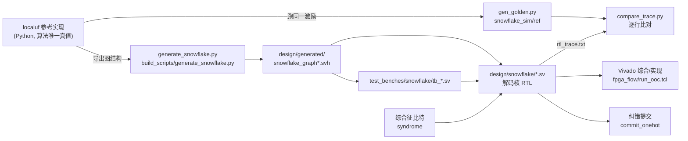
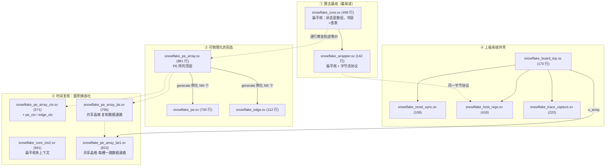
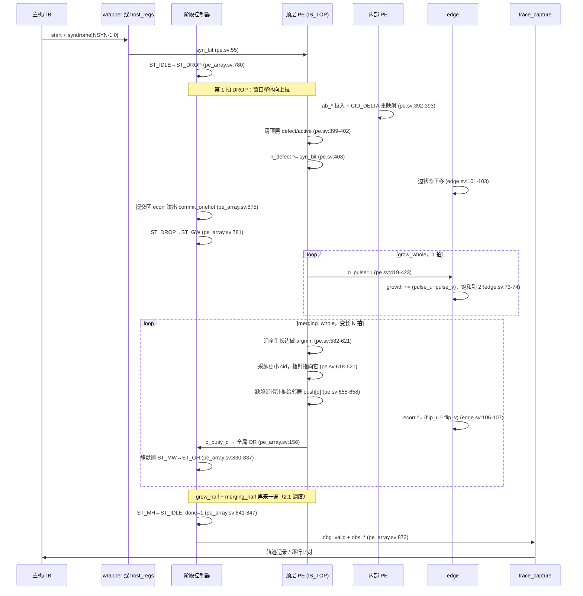
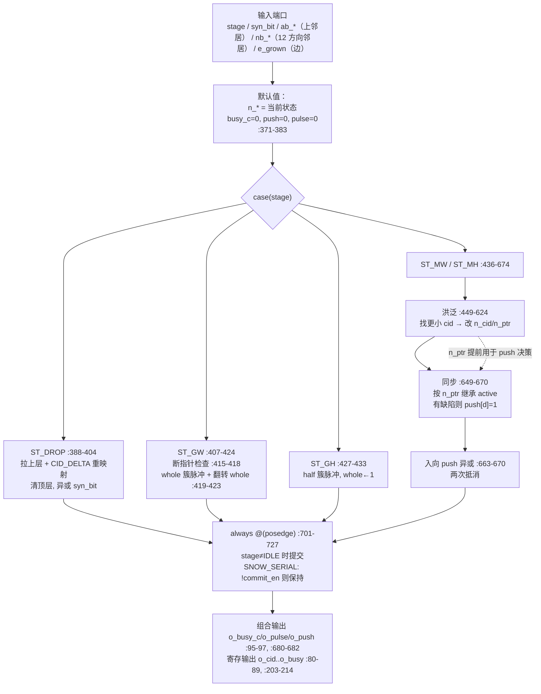
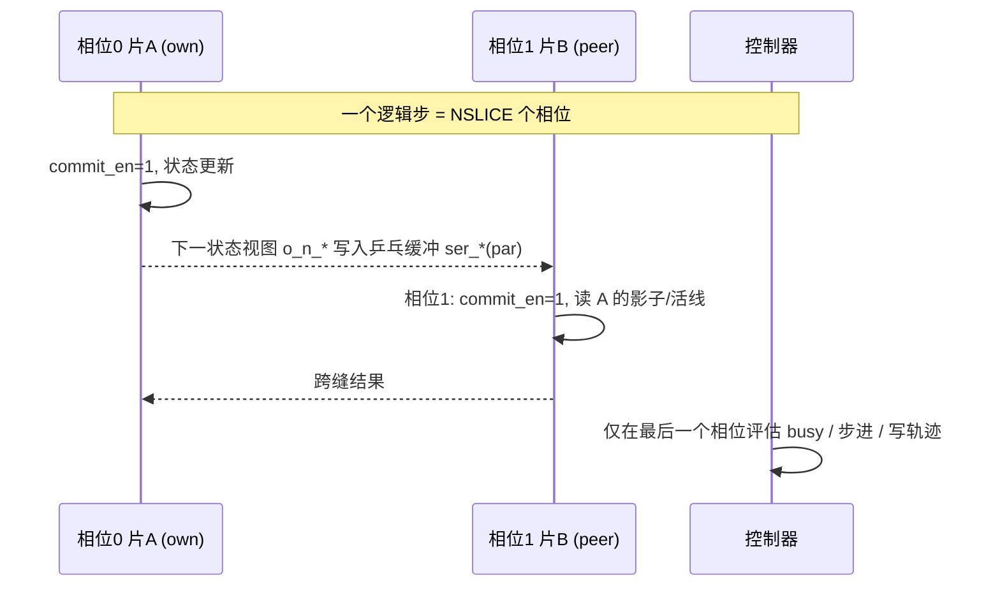
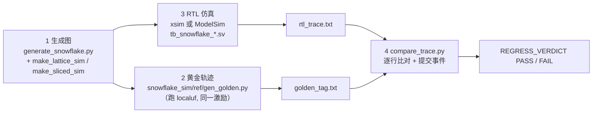

# Snowflake 流式量子纠错解码器 · 技术文档（接手指南）

> 面向对象：第一次接触本项目的资深 FPGA 逻辑工程师。
> 目标：读完全文后，你能独立回答"这个设计在算什么、数据怎么走、每个模块为什么长这样、改动一处会破坏什么不变量"。
>
> **本文不改动任何代码。** 所有引用均为只读核查结果。
>
> **路径约定**：下文 `H/` = `Helios_scalable_QEC-main/Helios_scalable_QEC-main/`（发布包把目录自我嵌套了一层，看到 `H/H/` 不要奇怪）。
> **行号口径**：所有 `文件:行号` 在 **2026-09-28** 对当前工作区代码逐条 `grep`/`sed` 复核过。本项目由 Python 生成器改写 RTL 树，行号会随再生成漂移；引用前请先 `grep -n` 定位同名信号，而不是相信本文的行号。
> **术语处理**：正文首次出现处以（*注：…*）就地解释，完整定义见 §12 术语表。

---

## 目录

- [§0 这份文档在项目里的位置](#0-这份文档在项目里的位置)
- [§1 最浅层：这个 FPGA 在做什么](#1-最浅层这个-fpga-在做什么)
- [§2 四个必须先建立的直觉](#2-四个必须先建立的直觉)
- [§3 顶层架构与形态地图](#3-顶层架构与形态地图)
- [§4 时钟、复位与 CDC](#4-时钟复位与-cdc)
- [§5 数据流：一个 syndrome bit 的一生](#5-数据流一个-syndrome-bit-的一生)
- [§6 逐模块详解](#6-逐模块详解)
- [§7 编译期开关总表](#7-编译期开关总表)
- [§8 时序、面积与实测数字](#8-时序面积与实测数字)
- [§9 验证体系：逐行回归](#9-验证体系逐行回归)
- [§10 新人踩坑清单](#10-新人踩坑清单)
- [§11 建议的阅读代码路线](#11-建议的阅读代码路线)
- [§12 术语表](#12-术语表)
- [§13 文件索引](#13-文件索引)

---

## §0 这份文档在项目里的位置

工作区里已经有若干**权威文档**，它们记录"结论与测量数据"。本文不替代它们，只做一件事：**把代码读通的路径铺平**。冲突时以权威文档为准。

| 文档 | 作用 | 什么时候查 |
|---|---|---|
| `fpga_flow/optimization_report.md` | 实测结论的唯一出口（4407 行，§0 是四问四答） | 任何"面积/时序到底多少"的问题 |
| `fpga_flow/snowflake_n_design.md` | 时间复用（snowflake-n）设计 | 看 slice/seam/lattice 之前 |
| `snowflake-on-helios-design.md` | 算法对照 + 术语表 + 改动清单 | 想弄清"为什么不用 Helios 的 PE" |
| `helios-decoder-walkthrough.md` | 上游 Helios（并查集 UF）解码器导读 | 只想懂被借用的那部分 |
| `snowflake_sim/README_snowflake.md` | 仿真与验证工作区说明 | 要跑起来时 |
| **`docs/Snowflake工程操作手册.md`** | 命令级操作手册：环境、生成表、仿真/综合/门级/上板的具体脚本与参数 | 要动手跑的时候（本文只讲原理，不给命令） |
| `NEXT_SESSION_PROMPT.md` | 交接文件：进度、用户决策 D1–D11、红线 | 每次开新会话先读 |
| **本文** | 代码结构、数据流、设计原理 | 第一次读 RTL 时 |

**两套 RTL 的边界**（极易混淆，务必先记住）：

- `H/design/snowflake/`、`H/design/board/`、`H/design/generated/snowflake_*.svh` —— 本项目自研的 Snowflake。
- `H/design/pe/`、`H/design/stage_controller/`、`H/design/channels/`、`H/design/wrappers/`、`H/design/generated/{root_hub_,top_module_,standard_planar_,decoder_stage_controller_}*` —— 上游 Helios。除 §6.9/§6.11 列出的少量复用件，**Snowflake 不经过它们**。
- `H/old_files/` —— Helios 之前的匹配解码器，`H/README.md` 不提它，读代码时排除。

---

## §1 最浅层：这个 FPGA 在做什么

### 1.1 一句话

它是一台**专用实时解码器**：上游是量子芯片的辅助比特（*注：ancilla qubit，用来探测错误而不直接承载信息的物理比特*）测量电路，每轮吐出一串 0/1；本 FPGA 把这串 0/1（叫**综合征**，syndrome）在几纳秒内解成"该翻转哪些边"的**纠错指令**，交给泡利帧（*注：Pauli frame，纠错可以只记账而不物理施加的常规做法*）累加。

### 1.2 输入输出契约

| 方向 | 信号 | 位置 | 含义 |
|---|---|---|---|
| 入 | `syndrome[SNOW_NSYN-1:0]` | `snowflake_core.sv:37`、`snowflake_pe_array.sv:51` | 窗口**最顶层**辅助比特的本轮测量差分，1 bit = 1 个探测器 |
| 入 | `start` | `snowflake_core.sv:36` | 单拍脉冲：启动一轮解码 |
| 出 | `commit_onehot[SNOW_NCOMMIT-1:0]` | `snowflake_core.sv:40` | 只在 `ST_DROP` 那一拍有效：提交区（*注：commit region，窗口底部 c 层，其纠错结果已经安全*）里哪几条边被翻转了 |
| 出 | `done` | `snowflake_core.sv:38` | 单拍脉冲：本轮结束 |
| 出 | `obs_*`（10 组打包总线） | `snowflake_core.sv:41-50` | 全部节点/边状态观测总线，只为验证与波形，功能上可关掉（`SNOW_NO_OBS`） |
| 出（上板） | AXI4-Lite 从机 | `snowflake_board_top.sv:52-68` | PS 端（ARM）读写寄存器，见 §6.10 |

`SNOW_*` 全部是 Python 生成器写进 `H/design/generated/snowflake_graph.svh` 的 `localparam`（例如 d=3 重复码：`SNOW_NN=12`、`SNOW_NE=13`、`SNOW_NCOMMIT=5`、`SNOW_NSYN=2`，见 `snowflake_graph_d3.svh:11-32`；表面码 d=3：`SNOW_NN=36`、`SNOW_NE=51`、`SNOW_NDIR=12`，见 `snowflake_graph_surface_d3.svh:12-20`）。**RTL 里没有一处硬编码码距或规模**，这是本项目最重要的一条设计纪律。

### 1.3 系统级数据流



要点：**算法真值在 Python（localuf），RTL 是它的逐拍镜像**。这条关系决定了 §9 的整个验证方法。

### 1.4 为什么是 Snowflake 而不是 Helios 的并查集

（*注：Helios 是一台已有的表面码 FPGA 解码器，算法是分布式 Union-Find，即"并查集"：把探测器按连通性聚成簇、生长、合并、剥离出纠错集*。）

| 维度 | Helios（UF） | Snowflake | 硬件后果 |
|---|---|---|---|
| 解码方式 | 批量：攒 d 轮一起解，滑动窗口高 2d | 流式 frugal：窗口高约 d，每轮只上移 1 层、提交 1 层，计算零丢弃 | 阵列高度减半；状态必须跨轮保留 |
| 簇奇偶性 | 用 direct channel 把消息路由到簇根做 XOR | 缺陷（*注：defect，被触发的探测事件，像个会移动的粒子*）沿指针逐边上推，相遇即湮灭 | 删掉整套消息网络，通信全退化为邻居链路 |
| 生长粒度 | 整数 +1/轮 | 半条边 +½/生长轮，且 2:1 调度 | 边生长值只有 2 bit（0/1/2 三态） |
| 未来边界 | 有（边界代价计数器） | 无 | 省掉 UD 边界逻辑与比较器 |
| 精度 | = UF | 逻辑比特寿命 +24.9(5)% | 主要收益 |

依据：`snowflake-on-helios-design.md:223-236`（差异表）、`:319-324`（收益）；数据来自工作区内两篇论文（`snowflake.pdf`、`FPGA-based Distributed Union-Find Decoder for Surface Codes.pdf`）。

---

## §2 四个必须先建立的直觉

### 2.1 直觉一：一切问题先变成"一张图"

解码图（*注：decoding graph，顶点=测量结果/探测事件，边=可能引起该翻转的独立错误机制*）是个 **3D 网格**：

- 两个空间轴 + 一个时间轴；
- **时间轴方向 = 下**，即越早的测量在窗口越下方，最新的在顶部；
- 每个顶点的邻居方向数 `SNOW_NDIR` 由噪声模型决定：重复码 4、表面码唯象噪声 12（`snowflake_graph_surface_d3.svh:19`）、旋转表面码电路级更多。

这张图不由人工描述，而由 `generate_snowflake.py` 从 localuf 的对象里**导出**，产出两类查询：

1. **规模/位宽常量**：`snowflake_graph_surface_d3.svh:12-32`；
2. **两类拓扑查询**：
   - 函数式（`case` 语句实现，供扁平核用）：`SNOW_IS_BND / SNOW_IS_TOP / SNOW_IS_BOT / SNOW_NODE_BELOW / SNOW_NODE_ABOVE / SNOW_NB / SNOW_EDGE_OF / SNOW_EDGE_U / SNOW_EDGE_V / SNOW_IS_COMMIT / SNOW_COMMIT_IDX / SNOW_SYN_NODE / SNOW_CID_DELTA / SNOW_REV / SNOW_PTR_STR`（`snowflake_graph_surface_d3.svh:34-1010`）；
   - **打包常量向量**（供 `generate` 块用）：`SNOW_ABOVE_VEC / SNOW_BND_VEC / SNOW_TOP_VEC / SNOW_BOT_VEC / SNOW_NB_VEC / SNOW_EB_VEC / SNOW_REV_VEC / SNOW_EU_VEC / SNOW_EV_VEC / SNOW_EABOVE_VEC / SNOW_ECOMMIT_VEC / SNOW_ECIDX_VEC`（`snowflake_graph_surface_d3.svh:1055-1069`）。

为什么两套？`snowflake_pe_array.sv:22-27` 的注释说得很直白：**Vivado 拒绝在 generate 体内对函数做常量折叠**（报 `unable to resolve 'SNOW_NODE_ABOVE'`），所以阵列版只能用常量位选去读打包向量，扁平核继续用函数。

关于`generate_snowflake.py`：  
它本身**不构造图**，而是"导出" localuf 已经建好的图：先 `make_code(kind, d, noise)` 用"码型 + 噪声模型 + `scheme='frugal'`（即流式窗口）"实例化 localuf 的码对象，再建一个 `Snowflake` 解码器对象，然后把解码器内部的 `NODES / EDGES / NEIGHBORS / FRIENDSHIP / CONTACT` 逐一读出来（`generate_snowflake.py:118-215`），翻译成 RTL 用的查表。所以它的角色是**格式转换器 + 单一事实来源的出口**——算法真值始终在 Python 的 localuf 里。  

它产出三样东西：① 一张 SystemVerilog 头文件，含规模/位宽常量和全套查表；② 同一张表的函数式与打包向量式两种写法；③ 一个 `*_part.json`（节点→时间层分区、跨区边清单），供多 FPGA 划分。另外它会同时写"带名字的图"和 canonical 的 `snowflake_graph.svh`（`:491-495`），并写 `// SNOW_GRAPH_FORMAT 3` 标记，防止综合流复用到过期缓存。


### 2.2 直觉二：一个节点一个 PE，一条边一个 edge 模块

`H/design/snowflake/` 的分工完全照此：

- `snowflake_pe.sv` —— 一个解码图顶点。持有 8 个状态量：`cid`（*注：cluster ID，所在簇的代表元，约定取簇内最小节点 ID*）、`active`（本簇本轮要不要动）、`whole`（簇已生长偶数次/奇数次）、`defect`（我这里有没有缺陷粒子）、`ptr`（指针：缺陷该往哪个方向推）、`grown`（本轮首生长轮是否已长过）、`unrooted`（正在去根化）、`busy`（我上一拍改过状态）。声明见 `snowflake_pe.sv:198-200`。
- `snowflake_edge.sv` —— 一条边。只持有 2 个状态量：`growth[1:0]`（生长值，饱和到 2 = "全生长"）和 `ecorr`（这条边被翻转了没有）。声明见 `snowflake_edge.sv:65-66`。
- **邻居之间没有任何仲裁、握手、缓冲、路由**（*注：这与 Helios 的 direct channel + FIFO + 路由表截然不同*）。跨节点的一切都是显式端口：`snowflake_pe.sv:63-68` 的 `e_grown / nb_valid / nb_cid / nb_active / nb_grown / nb_push`。这条性质是后面所有面积优化的前提——状态全局部化，才能变成 RAM 的一个地址位（§6.6/§6.7）。

### 2.3 直觉三：一拍 = 算法模型里的一个 timestep

分布实现的计算模型是**一次全局同步的状态更新**。RTL 忠实照做：

- 一个全局 `stage[2:0]` 广播给所有 PE 与 edge（`snowflake_pe.sv:54`、`snowflake_edge.sv:30`）；
- 所有单元**同拍**更新（`snowflake_pe.sv:701`、`snowflake_edge.sv:93` 的 `always @(posedge clk)`）；
- PE 不排队、不等握手。它只告诉控制器"我这一拍还会不会变"：组合输出 `o_busy_c`（`snowflake_pe.sv:95`、`:680`）。控制器把全阵列的 `busy_c` 或起来（`snowflake_pe_array.sv:156` 的 `assign any_c_busy = |busy_c_vec;`），**为 0 就认为该阶段已静默**，进入下一阶段。

这就是"分布式"的代价与好处：好处是没有中心瓶颈、通信全本地；代价是**每个变长阶段的时长 = 全阵列收敛所需拍数**，而那个全局 OR 树本身会成为关键路径（§8）。

### 2.4 直觉四：窗口滑动 = DROP 拍的"向上拉"

流式解码每轮把窗口上移一层：底层数据提交出去、整体下移一层、顶部注入新测量。

扁平核用**写下去**的写法：`snowflake_core.sv:198-222` 遍历每个节点，把它的状态写到 `SNOW_NODE_BELOW(n)`，再清顶层（`:211-214`）、异或新综合征（`:215-218`）、边同样下移（`:219-222`）。

阵列版必须反过来：一个 PE 不能写别人的寄存器，于是改成**从上拉**：`snowflake_pe.sv:388-404`。这正是生成器额外导出 `SNOW_NODE_ABOVE` 的原因（`snowflake_pe.sv:9-11` 注释）。

还有一个非直觉细节：状态下移时 `cid` 不是照抄，而是要加一个位移量——同一簇的节点在窗口移动后，其"簇内最小 ID"的语义随之改变：

```verilog
n_cid = (ab_cid == SNOW_RESET_CID) ? SNOW_RESET_CID
                                   : (ab_cid + SNOW_CID_DELTA(ab_cid));   // pe.sv:392-393
```

（*注：`SNOW_RESET_CID` 是全 1 的哨兵值，表示"此簇正在去根化"；见 `snowflake_graph_surface_d3.svh:23`。*）`SNOW_CID_DELTA` 的规则来自 localuf 的 `id_below` 公式（`generate_snowflake.py:94-102`）：ID 按 [墙节点 | 探测器] 分块、块内时间**降序**、常量步长，所以 `id_below = id + stride`。

---

## §3 顶层架构与形态地图

### 3.1 同一个算法，11 个 RTL 形态

这是本项目最容易迷路的地方：**不存在"唯一顶层"，而存在一条按研究目的递增的形态链**。



各形态"何时用"：

| 文件 | 行数 | 角色 | 你为什么要读它 |
|---|---|---|---|
| `snowflake_core.sv` | 498 | 扁平参考实现 | **算法最好的教材**：一个 `always @(*)` 里顺序扫过所有节点，和 localuf 的 Python 循环一一对应 |
| `snowflake_pe_array.sv` | 881 | PE 阵列顶层 | 真正拿去做综合/布线的形态；面积与时序结论都出自它 |
| `snowflake_pe.sv` | 730 | 单节点 | 全部算法语义在此 |
| `snowflake_edge.sv` | 112 | 单边 | 生长值与纠错位，最短的完整样本 |
| `snowflake_wrapper.sv` | 142 | 字节流外壳 | 看"复用了 Helios 的哪些件" |
| `snowflake_pe_ctx.sv` / `snowflake_edge_ctx.sv` | 730 / 123 | 带上下文地址的 PE/edge | 多上下文版的基本单元 |
| `snowflake_pe_array_ctx.sv` | 571 | 多上下文阵列 | 上下文轮转仲裁在此 |
| `snowflake_core_ctx2.sv` | 591 | 扁平核多上下文 | 对照用 |
| `snowflake_pe_array_lat.sv` | 766 | 共享晶格（复制数据通路） | 中间步骤：先证明 bank/地址可行 |
| `snowflake_pe_array_lat1.sv` | 823 | 共享晶格（合并数据通路） | **唯一被接进板级顶层的阵列** |
| `design/board/snowflake_*.sv` | 916 合计 | 上板外壳 | PS 驱动、轨迹回读 |

三个必须知道的"形态之间不变量"：

1. **语义等价**：`snowflake_pe_array.sv:13-15` 明说"阶段机与每阶段语义与扁平核完全相同，所以本设计应逐行复现扁平核的轨迹——这正是回归在检查的东西"。任何形态改动都必须过 §9 的逐行比对。
2. **生成物边界**：`snowflake_pe_ctx.sv:2` 写着 `GENERATED by fpga_flow/make_pearray_ctx.py -- do not edit by hand`。改逻辑要改生成器，不是改这个文件。
3. **lat1 是终点**：只有 `snowflake_pe_array_lat1` 被 `snowflake_board_top.sv:154` 例化；其余形态只活在仿真与综合队列里。

### 3.2 顶层端口对比

| | `snowflake_core` / `snowflake_pe_array` | `snowflake_wrapper` | `snowflake_board_top` |
|---|---|---|---|
| 时钟 | 单 `clk`（`:34` / `:48`） | 单 `clk`（`:19`） | 单 `clk`（`:48`） |
| 复位 | 同步高电平 `reset` | 同步高电平 `reset` | 异步输入 `pl_reset_in` → 内部同步（`:49`、`:103-110`） |
| 激励 | `start` + `syndrome[NSYN-1:0]` 并行 | 8 bit 字节流 + `input_valid/ready` | AXI4-Lite 寄存器写 |
| 输出 | `commit_onehot` + `obs_*` | 8 bit 串行 `output_data/valid/ready` | 寄存器回读 + 片上 BRAM 轨迹 |
| 例化的核 | 自身即核 | `u_core`（`:48-57`） | `u_array` = `snowflake_pe_array_lat1`（`:154`） |

端口名在 `core` 与 `pe_array` 之间**逐字相同**（对比 `snowflake_core.sv:33-53` 与 `snowflake_pe_array.sv:47-67`），测试台因此可以只换 DUT 实例（`tb_snowflake_core.sv:49-52`）。

---

## §4 时钟、复位与 CDC

（*注：CDC = clock domain crossing，跨时钟域。跨域信号若不被正确同步，采样时刻落在建立/保持窗口内会让触发器进入**亚稳态**（metastability），输出在一段时间内不确定，且可能采样到错误值——这是 FPGA/ASIC 里最难复现的一类 bug。*）

### 4.1 结论：本设计没有跨时钟域

- 全树只有一个时钟域。`snowflake_wrapper` 里 `fifo_wrapper` 只接了 `clk` 一个时钟端口（`snowflake_wrapper.sv:120-128`），是**同域 FIFO**，不是异步 FIFO。
- 上游 Helios 同样单域（`H/design/wrappers/single_FPGA_decoding_graph_dynamic.v:39` 用同步高电平 `reset`，无异步复位树）。
- 唯一真正的异步信号是板级 `pl_reset_in`，处理方式见 §4.2。

因此**读代码时不用担心 CDC**，但要担心 §4.3–§4.5 这四件事。

### 4.2 板级复位：异步进入 → 两级同步 → 分域拉长

`snowflake_reset_sync.sv`（模块声明 `:43`）做三件事：

1. **两级（实为 `SYNC` 级，默认 3）同步**外部异步复位：`parameter integer SYNC = 3`（`:49`）、移位寄存器 `reg [SYNC-1:0] sr`（`:59`）、同步链 `always @(posedge clk) sr <= {sr[SYNC-2:0], arst_in};`（`:81`），请求取 `req = sr[SYNC-1] | sw_reset`（`:82`）；`bus_rst` 也来自同一根同步链（`:94`），文件头 `:26` 把这概括为"2-FF for `bus_rst`、SYNC-deep shift for the stretch request"。异步复位/释放信号必须先被同步链接住，否则它的释放沿可能正好撞在业务触发器的建立/保持窗口里——这就是亚稳态的入口。`SYNC < 2` 会在 elaborate 期直接 FATAL（`:103-104`）。（*注：本文件没有 `ASYNC_REG` 属性；同步靠的是移位链结构本身与单时钟 `always @(posedge clk)`，若你把它改成真正的异步复位，需要自行补上该约束。*）
2. **结构化的上电复位**：计数器 `cnt` 依赖 FPGA 触发器的上电初值为 0（`initial cnt = 16'd0;` 在 `:75`，其作用与限制写在注释 `:63-74`），于是 `cnt < LEN` 在上电即为真，无需外部请求也能拉长复位（计数逻辑 `:86-90`）。核心表达式：`core_rst <= req | (cnt < LEN);`（`:89`），对外 `assign reset = core_rst;`（`:92`）。注释 `:70-74` 还专门对比了 `snowflake_pe_array_lat1.sv`——那边**刻意不放任何 initial image**，因为"initial 既会让综合看不见那条时钟化复位，又会在门级仿真里消失"。**同一件事在两个模块里的正确做法相反**，改复位路径前务必读这两处注释。
3. **复位分域**：`bus_rst`（AXI 侧）与 `core_rst`（解码核侧）分开（`:92-94`）。设计意图写在 `snowflake_host_regs.sv:66-68`：AXI 状态机只由 `rst_host` 复位，于是**核处于复位时总线仍然活着**，主机永远能轮询 `STATUS[4]`。这个"软复位核而不复位总线"的能力对整机软件是必要的。

`RESET_LEN` 默认 16（= 50 MHz 下 320 ns，`snowflake_reset_sync.sv:44-46`），并且注释指出"sweep 显示 1 起步的每个取值都能过逐行回归"——拉长只是舒适裕量，不是正确性条件。

### 4.3 片上轨迹 RAM：`MAXREC` 为什么必须是 2 的幂

`snowflake_trace_capture.sv` 把每个 `dbg_valid` 拍的一条记录写进一块宽 BRAM（文件头 `:3`；存储体声明 `reg [RWP-1:0] tmem [0:MAXREC-1]` 在 `:162`）。这里的真实约束不是"上电初值"，而是**写指针靠位宽截断自然回绕**：

- 宽度推导 `WORDS / RWP / RIW / WIW` 在 `:114-117`；
- 写口注释 `:179` 明写 "wraps: MAXREC is a power of two"，于是配套一个 elaborate 期 FATAL 检查（非 2 的幂或 `< 2` 直接报错，`:213-217`）；
- 读口是**寄存**的，所以主机必须先写 `TRACE_REC` 再读 `TRACE_DATA`（`:187-193`）；
- 记录布局通过 ID 寄存器回报给主机（`:204-209`），软件不必硬编码任何位宽；
- 容量选择依据见 `snowflake_board_top.sv:43-44`（d3 约需 7 条、d5 约需 68 条，默认 `TRACE_MAXREC=128`），更细的"为什么可以这么小"与 BRAM 列数估算在 `snowflake_trace_capture.sv:32-37`（d5 记录约 3800 bit ≈ 53 个 BRAM 列）。

### 4.4 复位预置在共享晶格里的特殊形式

`snowflake_pe_array_lat1.sv:38-41` 的注释点出一个不显然的问题：状态存在一个大向量 `bank` 里（`:115` 说明**为什么用一根打包向量而不是 Verilog memory**），运行期每拍只有一个地址被写，但**复位预置必须一次覆盖所有地址**，否则"第一个复位沿会写 `bank['x]`，什么都没预置成"。于是 lat1 单独有一条 per-slot 的时钟化预置路径（`:41`），并且它是**唯一**的预置路径（`:129`）。这是接手时最容易改坏的一处。

### 4.5 门级仿真的 `glbl.GSR` 陷阱

综合后网表里 Xilinx 原语带 `INIT` 值，靠全局置位信号 `GSR` 生效；仿真时 `glbl` 模块会把 `GSR` 拉高 100 ns，期间所有触发器被强制到 `INIT` 值。测试台必须**先等过这个窗口**再释放复位，否则第一个 `start` 被吞、状态机永远停在 `ST_IDLE`、产出一份空轨迹。实现见 `tb_snowflake_core.sv:103-111`（`ifdef SNOW_NETLIST` 下 `repeat (20) @(posedge clk);`，RTL 路径只等 5 拍）。

### 4.6 negedge：半周期时钟是真实存在的时序风险

同一 `clk` 上用 `always @(negedge clk)` 等于用两个半周期。这在本项目出现在缝（seam）缓冲里：`snowflake_pe_array.sv:238/255/266/272/278` 是 negedge，`250/261/308/356/379/399/411/422/431` 是 posedge。实测后果记录在 `fpga_flow/optimization_report.md` §6.18.6：d3 最差路径从 `cid_reg` 上升沿出发、落到 `seam_nb_push_reg` 的**下降沿**，5.44 ns 逻辑塞进 2.5 ns 预算，导致 f_max −11% 而逻辑级数反而从 30 降到 25。**教训：级数变少不等于更快**；`SNOW_SERIAL` 全用 posedge，正是为了消掉这类跨沿路径。

---

## §5 数据流：一个 syndrome bit 的一生



文字版走查（每步都指到代码）：

1. **注入**。`syn_bit` 是单 bit 输入端口（`snowflake_pe.sv:55`）。阵列版里每个 PE 拿到的 `syn_bit` 是 `syndrome[SYN_IDX]` 的常量选择（顶层例化 `snowflake_pe_array.sv:550` 起的 `snowflake_pe #(...)` 参数连接）。只有在顶部层且是探测器节点时它才被用：`if (K_IS_SYN) n_defect = n_defect ^ syn_bit;`（`snowflake_pe.sv:403`）。
2. **DROP 的三件事**（`snowflake_pe.sv:388-404`）：从上邻居拉状态并重映射 cid；顶层清 `defect/active`；异或新综合征。**提交位在这一拍输出**（`snowflake_pe_array.sv:875`；扁平核 `snowflake_core.sv:490-492`），所以纠错输出一轮只有一次。
3. **GROW 只是"发脉冲"**。PE 不持有生长计数器，它只发 `o_pulse`（`snowflake_pe.sv:96`、`:420`）；计数器在边里，两端脉冲相加并饱和到 2（`snowflake_edge.sv:71-74`）。2:1 调度把一次生长拆成两半：`ST_GW` 只给 whole 簇（条件 `active && whole`，`snowflake_pe.sv:419`），`ST_GH` 只给"已生长奇数次且本轮还没长"的簇（`active && !whole && !grown`，`snowflake_pe.sv:429`）。
4. **MERGING = 洪泛 + 同步**，一个 `always @(*)` 里两段：
   - 洪泛（`snowflake_pe.sv:582-621` 默认串行扫描）：沿全生长边找更小的 cid，找到就采纳并把指针指过去；
   - 同步（`snowflake_pe.sv:649-670`）：根节点按"我自己还有没有缺陷"重定 `active`；非根节点继承指针方向邻居的 `active`；如果我有缺陷且指针不指根，就往那个方向 `push[d]=1`（**这一步用的是组合出来的新指针 `n_ptr`，不是旧 `ptr`**——这是全局同步模型能把一次洪泛+一次同步压进 2 拍的原因）；收到的 push 做奇偶异或（两次推送互相抵消，`snowflake_pe.sv:664-665`），于是"两个缺陷相遇即湮灭"。
5. **静默判定**。每个 PE 组合报告"我这一拍会不会变"（`busy_c`），控制器 OR 全阵列（`snowflake_pe_array.sv:156`）；为 0 就退出该阶段（`:830`、`:846`）。
6. **观测与提交**。每步结束把全阵列状态打成一行文本（`tb_snowflake_core.sv:74-91`）或写进板级 BRAM（`snowflake_trace_capture.sv`）。

---

## §6 逐模块详解

### 6.1 `H/design/generated/snowflake_graph*.svh` —— 图常量表

生成器：`H/build_scripts/generate_snowflake.py`（657 行）。`emit()` 从 `:249` 起，先写规模/位宽（`:269-280`），再写函数式查表，最后写打包向量。

```bash
cd Helios_scalable_QEC-main\Helios_scalable_QEC-main\build_scripts
python generate_snowflake.py --code surface --d 5
# 可选：--dirs used  (表面码名义 12 方向实际用 6)
#       --noise circuit-level  (电路级噪声，会引入 SD/WD/NWD 等方向名)
#       --slices N  (>=2 时额外输出时间轴切片与缝描述到 *_part.json)
```

**关键机制：双写。** 生成器把同一份文本写到带名字的文件（`snowflake_graph_surface_d5.svh`）**并且**覆盖写到 `snowflake_graph.svh`（`generate_snowflake.py:491-495`）。而 RTL 里所有 `include` 写的都是**后者**：

```verilog
`include "../generated/snowflake_graph.svh"   // core.sv:20 / pe.sv:22 / pe_array.sv:28 ...
```

所以 `snowflake_graph.svh` 是一个**全局可变别名**：任何一次生成都把它重钉（re-pin）到新配置；同一棵树里不可能同时编译两种码距。**危险点**：当前工作区的 `snowflake_graph.svh` 是旧格式（`rep d=3`、4 方向，头部无 `SNOW_GRAPH_FORMAT` 标记，且**不含** `SNOW_PE_STW` 与 `SNOW_PTR_DOWN_MASK`），而各 `_*_d<d>.svh` 已是 FORMAT 3（标记见 `snowflake_graph_rep_d3.svh:3`，两个新常量见 `snowflake_graph_surface_d3.svh:31-32`）。直接编译会缺符号或静默用错图。**动手前先重新生成你要的那张图。**

**状态字宽度也来自这里**：`SNOW_PE_STW = 7 + SNOW_PTR_W + SNOW_CID_W`（`snowflake_graph_surface_d3.svh:32`，由生成器 `:320` 发射）。它被从晶格表搬进图表是有原因的——见 §6.7 的"内存墙"。

相关表还有两张：

- `snowflake_seam*.svh`（生成器 `fpga_flow/make_sliced_sim.py`）：切片与缝的端口清单。入口计数 `:24-29`（如 `SNOW_SEAM_AB_N=12`、`SNOW_SEAM_NB_N=12`）、跨缝标志/索引 `:38-66`、`SNOW_SEAM_NSLICE`（`:68`，如 =2）、每节点 `SNOW_SLICE_OF_VEC` 与每边 `SNOW_EDGE_OWNER_VEC`（`:70-71`）。
- `snowflake_lattice.svh`（生成器 `fpga_flow/make_lattice_sim.py`）：共享晶格几何与每 (槽, 上下文) 端口表。头部注明 `NSLOT=18 节点槽 / 27 边槽 / 2 slice`，`SNOW_PE_STW=16`、`SNOW_EDGE_STW=3`，并在 `:13` 处反向 include 图表（"晶格表扩展图表，所以先把它拉进来"）。

### 6.2 `snowflake_core.sv` —— 扁平参考实现（算法最好的教材）

模块 `:22`，参数 `ONE_ONE`（`:23-27`，用宏把选择钉死在综合里）、`DEBUG_OBS`（`:28-32`）。

结构极其规整，读一遍就懂整个算法：

| 区块 | 行号 | 内容 |
|---|---|---|
| 状态数组 | `:72-98` | `cid / active / whole / defect / ptr / grown / unrooted / busy` 按节点索引；`growth[1:0] / ecorr` 按边索引。`SNOW_KEEP_STATE`（`:72-86`）给它们加 `(* keep = "true" *)`，用于消融实验时防止 Vivado 把整条环路剪掉 |
| 组合下一值 | `:101-110` | 同名 `c_*` 数组 |
| 组合大块 | `:176-384` | 按 `stage` 分支；`ST_DROP` 在 `:198-222`，`grow_half` 清 `unrooted` 在 `:263`，洪泛 argmin 在 `:288-321`，同步在 `:324-340`，`any_c_busy` 汇总在 `:382-383` |
| 时序大块 | `:387-496` | `always @(posedge clk)`：复位 `:403-410`、阶段机 `:416-462`、状态写回 `:467-475`、轨迹/提交 `:479-493` |

阶段编码 `ST_IDLE=0, ST_DROP=1, ST_GW=2, ST_MW=3, ST_GH=4, ST_MH=5`（`:61`）。指针编码用一个偏移把"方向号"变成"指针值"：`DIR2PTR(d) = d+1`，`0` 表示 C（根）（`:64-69`）。

洪泛的最小搜索（`:300-321`）是标准串行循环，注意 `break` 的写法（`:303` 附近注释 `synthesis-safe early exit`）——它不是随手写的语法糖，而是**复刻参考实现的语义**：遇到持 `RESET_CID` 的邻居就停止考察后续方向。§6.4 会看到这个 `break` 造成的一个"丑陋但必须保留"的行为。

### 6.3 `snowflake_edge.sv` —— 一条边

模块 `:23`，唯一参数是占位用的 `ZZZ_ANCHOR`（`:26`，注释 `:24-25` 解释：条件端口不能放在端口表首位，可移植性问题，所以先放个参数）。

三条规则（头注释 `:9-12` 即算法定义）：

```verilog
wire [1:0] inc     = {1'b0, u_pulse} + {1'b0, v_pulse};                 // :73
wire [1:0] grown_n = (growth + inc > 2'd2) ? 2'd2 : (growth + inc);     // :74  饱和
...
end else if (merging) begin
  if (flip_u ^ flip_v) ecorr <= ecorr ^ 1'b1;                           // :106-107 两次翻转抵消
```

`DROP` 时边**照抄上层的自己**（`:101-103`，读 `above_growth/above_ecorr`），这就是 §2.4 的窗口下移在边上的形式。

**为什么"两次翻转抵消"是对的**：头注释 `:12` 说明 `ecorr ^= (flip_u ^ flip_v)`。两个端点在同一拍把同一条边各推一次是常态（缺陷相遇湮灭），净效果必须为 0。因此 `pe_push[·][·]` 必须**原样**接进 `flip_u/flip_v`——`snowflake_pe_array.sv:656-660` 正是如此（`XS_EFU ? seam_ef[...] : pe_push[U][DU]`）。这个对称性是逐行等价的基础之一。

### 6.4 `snowflake_pe.sv` —— 核心，必须逐段读



**端口分区**（`:52-145`，理解条件端口就理解了本项目的扩展方式）：

| 行号 | 端口组 | 归属 |
|---|---|---|
| `:52-55` | `clk/reset/stage/syn_bit` | 全局 |
| `:57-61` | `ab_cid/ab_active/ab_whole/ab_defect/ab_ptr` | DROP 拉取 |
| `:63-68` | `e_grown/nb_valid/nb_cid/nb_active/nb_grown/nb_push` | NDIR 打包邻居 |
| `:69-76` | `m_pass[1:0]` | 仅 `SNOW_LAT`（两趟 merging） |
| `:80-89` | `o_cid…o_busy` | 非 `SNOW_LAT`（晶格版里状态不在 PE） |
| `:90-94` | `st_in/st_out` | 仅 `SNOW_LAT` |
| `:95-97` | `o_busy_c/o_pulse/o_push` | 恒存在（**组合**输出） |
| `:98-106` | `o_n_cid/o_n_active/o_n_grown` | 仅 `SNOW_SLICED`（缝 D 影子） |
| `:107-116` | `mts_scan/mts_mw/mts_sub` | 仅 `SNOW_MINTS` |
| `:117-129` | `commit_en/o_n_whole/o_n_defect/o_n_ptr` | 仅 `SNOW_SERIAL` |
| `:130-143` | `p_id/p_has_above/p_is_bnd/p_is_top/p_is_bot/p_is_syn` | 仅 `SNOW_LATTICE`（身份由参数变为数据） |
| `:144` | `zzz_never_used` | 语法垫片，让前面的逗号永远合法 |

**身份别名 `K_*`**（`:167-183`）：普通构建下 `K_ID` 等是 `localparam`；`SNOW_LATTICE` 下是线网（驱动值）。因为下游一律写 `K_*`，同一份逻辑体同时服务两种构建——这是本项目"用宏复制形态但不复制语义"的样板手法。

**洪泛的三种实现**（互斥，由嵌套 `` `ifdef/`else `` 选择）：

| 变体 | 行号 | 说明 |
|---|---|---|
| 默认串行扫描 | `:579-621` | `for (d=0; d<SNOW_NDIR; ...)`，综合成 NDIR 级**串联比较器链**；`:589` 的 `break`、`:604-609` 的 `<` 比较、`:618-621` 的循环后覆盖 |
| `SNOW_MINTREE` | `:454-523` | 平衡 log 深度 argmin 树，语义逐条复刻（见下） |
| `SNOW_MINTS` | `:525-577` | 把扫描按时分分成 `MTS_G` 个子拍，最后一个子拍由本分支扫（常量位选，无运行时 mux） |
| `SNOW_ABL_MIN` | `:595-610` | **只综合不仿真**的消融：保留 merging 通路，只删 argmin 比较器，用来量"最小搜索值多少 LUT" |

必须理解的一个**语义怪癖**（`SNOW_MINTREE` 的注释 `:461-466` 把它讲透了）：参考实现的串行循环里，若 `!unrooted` 且某方向邻居持有 `RESET_CID`，循环会在那里 `break`，于是**只考察 `d < first_rst` 的方向**；该处赋的 `n_cid = RESET_CID` 之后又会被"循环后 best_found 覆盖"规则冲掉。真正的持久效果只剩两条：`busy_c=1` 和"扫描被截断"。所以 `MINTREE` 版本必须做**优先级编码** `mt_first`（`:473-476`）、把前缀外的候选掩成"永不胜出"的全 1（`:486-489`），并在 `:510-515` 复刻那条"先赋 RESET 再被覆盖"的次序。**这里就是逐行等价最难调平的地方，也是改 merging 数据通路时的雷区。**

**去根化（unrooting）**是 Snowflake 特有机制（*注：窗口上移时，若某个簇的根被挤出了窗口底部，簇就"掉了根"；必须把这棵指针树重置，让簇重新以自己新的最小 ID 为根*）：

- 触发：`ST_GW` 里 `if (K_IS_BOT && SNOW_PTR_DOWN_MASK[ptr])`（`:415-418`）—— 底层节点且指针**编码里含 'D'（向下）**，就把 `n_cid` 置 `RESET_CID`、指针清回 C。
- 完成：merging 里 `if (cid == SNOW_RESET_CID) { busy_c=1; n_cid=K_ID; n_unrooted=1; }`（`:449-452`），约 2 拍。
- 复位：`ST_GH` 清 `n_unrooted`（`:428`），`ST_DROP` 也清（`:390`）。

⚠️ 这个检查的历史很能说明"逐行"的价值：注释 `:408-414` 记录，这里曾经写成 `ptr == SNOW_PTR_D`，在两种唯象噪声图上恰好等价，但在**所有电路级噪声图**上不等价（它们新增 `SD/WD/NWD`（未旋转）与 `E2D/SED/SWD`（旋转）这些同样含 'D' 的方向名），导致 t=0 层的那些节点**静默地从不去根化**——`fpga_flow/optimization_report.md` §6.32 量出 7120 行轨迹里错了 25 行。现在改用生成表里的位掩码 `SNOW_PTR_DOWN_MASK`（`snowflake_graph_surface_d3.svh:31`，值 `16'd1106`）。

**MINTS 时分的正确性论证**（`:247-364`）：子拍 0 从本节点状态起步，后续子拍接着上一组的结果走（`:287-293`）；扫描期间控制器把 PE 看到的 `stage` 伪装成 `ST_IDLE`（`snowflake_pe_array.sv:103` 的 `stage_eff`），于是**所有已提交状态保持不变**；只有最后一个子拍真正执行 merging 分支并提交。这样轨迹仍然保持"每个逻辑 merging 步一行"的黄金节拍。注释 `:255-261` 还记录了一次**实测否决**的方案：让 merging 分支直接吃槽单元的组合输出（"单比较器组"）在 d3 上 5,770 LUT/6.466 ns/24 级，反而差于本方案的 5,529 LUT/4.799 ns/17 级，因为运行时 case mux 被放进了最后子拍的关键路径。

**提交逻辑**（`:701-727`）：复位初值 `cid=K_ID, active=0, whole=1, defect=0, ptr=C, grown=0, unrooted=0, busy=0`（`:702-711`）；`SNOW_SERIAL` 下 `else if (!commit_en) ;` 保持所有寄存器（`:712-716`）；否则 `stage != ST_IDLE` 时整体写回（`:717-726`）。`SNOW_LAT` 下这一段整个消失，改为纯计算输出 `assign st_out = {n_pb, n_cid, n_active, n_whole, n_defect, n_ptr, n_grown, n_unrooted, busy_c};`（`:698-699`），状态搬到阵列的寄存器堆（字段偏移 `:147-162`）。

### 6.5 `snowflake_pe_array.sv` —— 阵列顶层与全局控制器

**连线（`generate` 双循环）**

- 节点循环 `:448` 起 `for (n = 0; n < NN; n = n + 1) begin : g_pe`。拓扑全部来自打包向量的**常量位选**：`ABOVE = SNOW_ABOVE_VEC[n*NW +: NW]`（`:449`）、`BND = SNOW_BND_VEC[n]`（`:452`）、邻居 `NBR = SNOW_NB_VEC[(n*NDIR+d)*NW +: NW]` 与对应边 `EB = SNOW_EB_VEC[...]`（`:496-497`）。**邻居路由是编译期常量**，没有 ROM、没有运行时选择器。
- 边循环 `:598` 起 `for (e = 0; e < NE; e = e + 1) begin : g_edge`，端点取 `SNOW_EU_VEC/SNOW_EV_VEC`，边方向取 `SNOW_EDIRU_VEC/SNOW_EDIRV_VEC`（`:599-600` 起，实例化端口在 `:653-672`）。
- 提交位从边直接引出：`if (IS_CMT) assign commit_bits[C_IDX] = ed_ecorr[e];`（`:683-685`），其中 `IS_CMT/C_IDX` 来自 `SNOW_ECOMMIT_VEC/SNOW_ECIDX_VEC`。
- 观测总线 `obs_*` 用 `for` 循环把每个 PE/edge 的状态拼进打包向量（`:689-715`），面积可测得 0–1%，但**布线拥塞的真凶是它的扇出**（`fpga_flow/optimization_report.md` §6.12.3，d7 现象）。

**全局控制器**（`:720-879`，`always @(posedge clk)`）

```verilog
ST_IDLE: if (start) begin stage <= ST_DROP; step_cnt <= 8'd1; end   // :780
ST_DROP: begin stage <= ST_GW; step_cnt <= 8'd1; end                // :781
ST_GW:   begin stage <= ST_MW; step_cnt <= 8'd1; end                // :782
ST_MW:   ... if (!any_c_busy) begin stage <= ST_GH; ... end         // :830-837
         ... else step_cnt <= step_cnt + 8'd1;
ST_GH:   begin stage <= ST_MH; step_cnt <= 8'd1; end                // :840
ST_MH:   ... if (!any_c_busy) begin stage <= ST_IDLE; done <= 1'b1; // :841-847
```

1:1 基线（`SNOW_ONE_ONE`）只走 `DROP→GROW→MERGING`，在 MW 就退出（`:832` 的 `if (ONE_ONE)`）。

`step_cnt` 就是**每阶段的拍数计数器**：进入阶段置 1，每多待一拍加 1，随 `dbg_step` 一起进轨迹（`:857-876`）。`dbg_valid` 的规则值得注意：merging 阶段中"全阵列已静默但还没切换的那一拍"被刻意**屏蔽掉不写轨迹**（`:870`），这正是 `SNOW_BUSYREG` 能多花一拍而仍逐行等价的原因（见 §7）。

`all_busy`（`:155`）与 `any_c_busy`（`:156`）是两个不同的静默来源，前者用寄存的 `busy`，后者用组合的 `busy_c`。默认控制器用 **`any_c_busy`**——它更"即时"，但要付出一条横跨整个阵列的组合 OR 树；实测 d7 的关键路径正是 `cid_reg → 比较链 → busy_c → 392 输入 OR → stage_reg/CE`，33 级、67% 是布线（注释 `:783-795` 原文记录）。这就是 `SNOW_BUSYREG` 的靶子。

### 6.6 多上下文家族（`ctx` / `ctx2`）

**概念**（*注：上下文切换 = 把解码图切成若干子图，多个"逻辑解码轮"分时复用同一套物理数据通路；状态多份，逻辑只一份。Helios 论文用这招在同一块板上解 d=51。*）

- `snowflake_pe_ctx.sv`：由 `fpga_flow/make_pearray_ctx.py` **生成**（`:2` 明示勿手改）。新增端口 `ctx`（`:63`）；状态数组变成 `[0:NCTX-1]`（`:196`）；输出按 `ctx` 读（`:206-213`，如 `assign o_cid = cid[ctx];`）；组合扫描也从 `cid[ctx]` 起步（`:287`）；写回只碰 `[ctx]`。
- `snowflake_pe_array_ctx.sv`：顶层。`NCTX` 由 `SNOW_CTX1` 在 1/2 之间切换（`:55-58`）——**同一个 source 同时产出 NCTX=1 与 NCTX=2 两版**，避免"另开一份代码"带来的语义漂移。端口 `start/syndrome/done/commit_onehot` 全部按上下文向量化（`:63-67`），并多出 `dbg_ctx`（`:78`）。每上下文各有一份 `stage/step_cnt`，控制器用 `stage_sel`（`:216`）选出"当前上下文"的阶段喂给 PE（例化 `:402` 同时传 `.ctx(ctx_sel)` 与 `.commit_en(...)`），轨迹打印按 `stage_sel`（`:533`、`:559-564`）。
- `snowflake_core_ctx2.sv`（`:31`）：扁平核上的等价物，用于对照。

**为什么值得做**（结论出自 `optimization_report.md` §0）：flat 形态下上下文切换**不划算**（只省 7.2%，吞吐还 −13%）；PE 阵列形态下省 **32.9–37.7%** 面积而吞吐反而快 11.5%。所以"上下文切换属于 PE 阵列"。

### 6.7 共享晶格家族（`lat` / `lat1`）与内存墙

**动机**：多上下文是"每个上下文一套 PE"；共享晶格更进一步——**整个 n 层时间窗共用一张 (槽 × 上下文) 寄存器堆**，逻辑通路只一份。

两个易混的宏（务必分清）：

- `SNOW_LAT` —— **晶格形态**：PE/edge 变成**无状态数据通路**，状态在阵列的 bank 里（`snowflake_pe.sv:90-94/147-162/186-196/695-699`、`snowflake_edge.sv:37-45/61-63/84-85`），并引入 `m_pass` 两趟 merging。
- `SNOW_LATTICE` —— **身份数据化**：把"我是哪个节点"从 elaborate 期参数变成每相位驱动端口（`snowflake_pe.sv:130-143/167-183`）。

`snowflake_pe_array_lat.sv`（`:47`）：复制 NSLOT×NCTX 份数据通路、共享一份 bank，先证明地址计算与观测总线可行。
`snowflake_pe_array_lat1.sv`（`:45`）：**每槽一路数据通路**（lat1 的 "1"）。头注释 `:17-41` 列出与 lat 的四点差异：per-context ROM 被删（`:17`）、两趟 merging 常开（`:25`）、预置必须一次覆盖全部 bank（`:38-41`）、影子行静默检测（`:174-240`）。关键实现：状态 bank 用**一根打包向量而不是 Verilog memory**（`:115`），两趟由 `m_pass_w = (mrg_running && any_run) ? (lat_bpass ? 2'd2 : 2'd1) : 2'd0;` 生成（`:141-150`），边只在 pass B 提交（`edge_en`，`:147`）。

**两趟 merging 为什么必需**（`snowflake_pe.sv:69-76/437-446/625-646`）：扁平阵列里，消费者读的是生产者**组合**的 `push`。合并成一路数据通路后，一个 cell 无法再去戳"晚于自己相位的邻居的组合 push"，于是把"生产者侧的推送决定"压成一个状态位 `pb`：`n_pb = (!K_IS_BND) && defect && (n_ptr != SNOW_PTR_C);`（`:643`）。注释 `:632-639` 特别警告：不能省略 `!K_IS_BND`——边界节点在黄金轨迹里确实存在 `defect=1` 且 `pointer != C` 的情形（取证脚本 `fpga_flow/check_pb_bnd.py`：surface d3 的 `seam` 有 10 次、surface d5 有 5 次、d5 `seam` 有 22 次），扁平阵列在每一次里都抑制了推送。

**内存墙**（`snowflake_pe.sv:23-38`，本项目最贵的一课）：PE 曾经在 `SNOW_LAT` 下 include 整份晶格表，只为取一个 `SNOW_PE_STW`。而 PE 是**每槽例化一次**的（rotated d7 有 548 个实例），于是每个实例都 elaborate 一遍全表：RTL elaboration 峰值约 25–38 MB/实例 → rotated d7 要 13.2 GB、未旋转 18.5 GB，**在 16 GB 机器上根本构建不出来**。修复办法是把 `SNOW_PE_STW` 变成图表的纯函数（`:32-35`），并且注释 `:37-38` 立下红线：**不要把 `SNOW_LAT` 的 include 加回这个文件。**

**几何前提**：共享晶格成立的条件是解码图确实是规则 3D 网格、每方向一个常量索引偏移、每个时间层空间坐标集相同——由 `fpga_flow/check_lattice_geometry.py` 在 5 个配置（surface d3/d5/d7/d21 + rep d3）上逐条证明（`optimization_report.md` §6.19）。这一步是 go/no-go：若需要每上下文的布线 ROM，d21 约 1.45M LUT，超过整块器件。

### 6.8 切片、缝与乒乓协议（`SNOW_SLICED` / `SNOW_SERIAL`）

**概念**：把窗口沿**时间轴**切成 n 片（slice），片之间的那条边界叫**缝**（seam）。跨缝的一切交互列成六类端口（A–F），由 `snowflake_seam*.svh` 描述（`fpga_flow/make_sliced_sim.py` 生成）。

**方向规则**（本项目最精妙的一条不变量，`snowflake_pe_array.sv:509-513` 注释原文）：组合跨缝信号的接法取决于**源相位与目的相位的先后**：

- 源相位**晚于**目的 ⇒ 目的本步就该看到"源更新后的值"，于是**直接接活线**（zero cost，`seam_*` 表里那个位置被掩掉、连线走 live 分支）；
- 源相位**早于**目的 ⇒ 源本步已经提交完了，于是**在源自己相位末尾锁存一次 F(Q)**，用单缓冲读。

这条规则有两个推论，都被记成了红线：

1. **缝索引必须按几何配对**（第 k 个边界槽 ↔ 第 k 条缝表项），不能按枚举顺序；否则缝索引退化成每上下文一个任意常量，d21 约 +100K LUT。
2. **任何被全局控制器消费的全阵列组合归约必须在相位 0 采样，而不是 `phase_last`**。踩过的坑（`optimization_report.md` §6.18）：状态行 2314/2314 全对，但 6 次提交事件 0/6 —— 一种"静默空跑"的失败形态。

**同一拍影子方案 `SNOW_SLICED`**（`snowflake_pe_array.sv:158-279`）：negedge 采当前 Q、posedge 采 `o_n_*` 下一状态视图（`:238/255/266/272/278` vs `:250/261`），配活度计数器 `seam_live_cnt/seam_push_cnt/seam_flip_cnt`（`:216-230`）。它做到了 6/6 逐行 PASS，但代价是 §4.6 的半周期路径。

**乒乓串行方案 `SNOW_SERIAL`**（`snowflake_pe_array.sv:281-441`）：每逻辑步跨 `SNOW_SEAM_NSLICE` 个相位，相位寄存器 `phase` 与乒乓位 `par`（`:303-313`，`phase_last` 在 `:305`、`par_r` 在 `:306`），双缓冲状态组 `ser_*`（`:315-324`，示例 `ser_ab_cid[par][k] <= pe_n_cid[PEER];` 在 `:364`）、单缓冲的组合跨缝类（`:326-341`）、generate 循环 `:352-438`。PE/edge 在 `commit_en` 为低时**保持状态但保持组合输出活着**（`snowflake_pe.sv:712-716`、`snowflake_edge.sv:99`；边例化的 `.commit_en(phase == EOWNER)` 在 `snowflake_pe_array.sv:626`）。FSM 的串行分支在 `:737-777`，`commit_hold` 的提交在 `:775-776`。

**周期账**（实测，`optimization_report.md` §6.18）：`cycles = NSLICE × live + idle`，如 2×89+31=209、2×92+31=215 ⇒ 渐近时延乘子恰为 n。它**不省面积**（所有邻居 PE 仍被例化），存在的意义是**把协议先验通**——共享晶格必须用同一套跨缝协议。



### 6.9 `snowflake_wrapper.sv` —— 字节流外壳（这里看见被借用的 Helios）

142 行的小模块，是"Snowflake 复用 Helios 资产"的唯一集中处：

| 复用件 | 出处 | 在此的用法 |
|---|---|---|
| `parameters/parameters.sv` | `snowflake_wrapper.sv:30` 内 include；常量取于 `:32-33` | 字节协议 `START_DECODING_MSG=8'h01` / `MEASUREMENT_DATA_HEADER=8'h02`（`H/parameters/parameters.sv:16-17`） |
| `fifo_wrapper` | 实例 `:120-128` | 每轮输出字缓冲，声明在 `H/design/generics/fifo_fwft.v:123` |
| `serializer` | 实例 `:130-138` | 24 bit 宽字 → 8 bit 串行，声明在 `H/design/channels/serdes.sv:1` |
| 架构思想 | `:48-57` 核例化 + `:75-117` 输入 FSM | "一节点一处理单元 + 全局阶段控制" 与 "逐轮装载/窗口滑动" |

输入 FSM 四态（`state` 定义与注释在 `:37`，行为 `:75-117`）：IDLE 等 `0x01/0x02`（`:83-92`）→ COLLECT 收 1 字节综合征（`:93-100`）→ DECODE 等 `core_done` 并把 DROP 拍吐出的提交位**或累加**进 `commit_r`（`:101-110`）→ EMIT 交给 FIFO+serializer（`:111-113`）。输出字布局 `[cyc_idx | padding | commit]`（`:68-70`）。

未复用：Helios 的 PE 本体与图生成器（理由见 `snowflake_sim/README_snowflake.md:150`：Snowflake 的节点语义差别大，且上游 scalable 生成器存在多驱动缺陷）。

### 6.10 `design/board/` —— 上板系统外壳

`optimization_report.md` 与 `snowflake_host_regs.sv:4` 都把这层称为"这个项目从来没有过的系统外壳"。四个模块：

- **`snowflake_reset_sync.sv`**（`:43`）：§4.2。
- **`snowflake_host_regs.sv`**（`:76`）：AXI4-Lite 从机 + 寄存器堆。实现刻意小：单 outstanding 读、单 outstanding 写、AW/W 各自捕获、1 拍读延迟、读数据由"被接受地址"的组合译码再寄存（说明见 `:70-72`）。写点：`CTRL`(0x000, W1P 位脉冲)、`TRACE_REC`(0x018)、`TRACE_WIX`(0x01C)（`:231-233`）；SYN 窗口 0x100…、COR 窗口 0x200…。关键读点与含义在文件头 `:24-64` 的映射表，代码在 `:380-405`，其中 `0x034 ID_MAGIC = 0x534E0101`（"SN",v1,if1）、`0x038/0x03C/0x040/0x044` = NN/NE/NCOMMIT/NSYN、`0x048` = `{8'd0, NDIR, PTR_W, CID_W}`、`0x054/0x058` = NSLOT/NCTX。**这套 ID 块的意义是：软件在读任何结果之前，先证明比特流里到底是哪个配置。**
- **`snowflake_trace_capture.sv`**（`:65`）：把每拍的 `obs_*` 打成一个 BRAM 记录（记录布局说明 `:40-61`，宽度推导 `:114-117`，记录装配 `:119-159`，写口 `:162`/`:167-185`，寄存读口 `:187-193`，布局回报给主机 `:204-209`，`MAXREC` 合法性检查 `:213-217`）。
- **`snowflake_board_top.sv`**（`:40`）：装配。`include` 的是**晶格表**（`:38`）而非图表，例化的核是 `snowflake_pe_array_lat1`（`:154-164`），`NCTX_/NSLOT_` 直接取自表（`:71-72`）。复位链 `:103-110` → 主机 `:112-136` → 轨迹 `:138-152` → 阵列。`core_rst_busy` 通过 `STATUS[4]` 对外可见，并留了一个 `unused_core_rst_busy` 线网防止 OOC 综合报悬空（`:166-168`）。

### 6.11 上游 Helios：只需知道这些就够

若你只关心 Snowflake，Helios 侧只需要三句话 + 一个警告：

1. **Helios 的真顶层**在 `H/design/wrappers/`：单板自含版是 `Helios_single_FPGA_wrapper.v:1` → `module Helios_single_FPGA`（声明于 `Helios_single_FPGA_core.v:1`），内部 `single_FPGA_decoding_graph_dynamic_rsc`（`core:55`）+ `unified_controller`（`core:71`，声明于 `H/design/stage_controller/control_node_single_FPGA.v:1`）。多 FPGA 版的顶层是 `design/generated/root_hub_0.v` 与 `top_module_for_leaf_1.v`。
2. **PE 阵列与边**：`H/design/wrappers/single_FPGA_decoding_graph_dynamic.v:78` 例化 `processing_unit`，边为 `neighbor_link_internal`（`:157/:180/:208`）。并查集语义：每 PE 持 `root`/`parent_vector`（`H/design/pe/processing_unit_single_FPGA_v2.v:74-80`），生长计数器在边里且 `LENGTH = 2 × 边权`（`H/design/channels/neighbor_link.sv:3-4`——Snowflake 的 0/½/1 三态正是这个 ×2 刻度的特例）。
3. **警告：上游 Helios 的 `.sv` 那棵树开箱不可综合。** `H/parameters/parameters.sv:4-13` 只有 8 个旧阶段名，而 `processing_unit.sv:197/471/479` 用 `STAGE_SPREAD_CLUSTER / STAGE_GROW_BOUNDARY / STAGE_SYNC_IS_ODD_CLUSTER / STAGE_RESULT_CALCULATING`——后者只存在于本地打过补丁的副本 `fpga_flow/helios_baseline/parameters/parameters.sv:13-17`。基线综合请用 `fpga_flow/helios_baseline` + `fpga_flow/synth_helios*.tcl`，别从上游仓库直接起。
4. 另外几个会浪费你时间的坑：`module processing_unit` 与 `module neighbor_link` 各有**两个同名实现**（`processing_unit.sv:6` vs `processing_unit_single_FPGA_v2.v:5`），按阶段词汇表选文件；`final_arbitration_unit` 是常量绑死的死逻辑；`get_boundry_cardinality` 恒输出 `1'b0`；`interconnection_model`（模块名拼错为 `interonncetion_model`）仅仿真；AXI IP `qec_3_axi_v1_0` 存在但**并未接到解码器上**。

---

## §7 编译期开关总表

下表"测试点"指宏在 RTL 中被 `` `ifdef `` 检测的位置。

**纪律**：所有新开关都是 `` `ifdef `` 形式且**默认关闭**，默认路径必须逐字节不变。这些宏同时出现在 RTL、生成器与综合流的 tag 里——仅就 RTL 而言，`` `ifdef `` 出现次数分布为 pe_array 35 / pe 25 / pe_ctx 23 / pe_array_ctx 19 / pe_array_lat1 14 / edge 8 / edge_ctx 8 / core 6 / core_ctx2 6 / pe_array_lat 5。

| 宏 | 测试点（RTL） | 架构上改变了什么 | 实测代价/收益 |
|---|---|---|---|
| `SNOW_ONE_ONE` | core `:23`、pe_array `:37`、pe `:419` | 1:1 调度：`DROP→GROW→MERGING`，MW 即收尾 | 面积略小、时延更低，精度差（阈值 0.375% vs 0.735%） |
| `SNOW_NO_OBS` | core `:28`、pe_array `:42` | 关掉 `obs_*` 总线 | 面积探针，0–1% |
| `SNOW_KEEP_STATE` | core `:72` | 给状态数组加 `(* keep *)` | 消融实验专用，防 Vivado 剪掉整条环路 |
| `SNOW_ABLATE_MERGE` | core 的 merging 分支 | merging 变单拍 no-op | **只综合不仿真**，量 merging 数据通路占比（76–77%） |
| `SNOW_ABL_MIN` | pe `:595-610` | 保留 merging，只删 argmin | 只综合不仿真 |
| `SNOW_MINTREE` | pe `:454-523` | 串行比较链 → 平衡 log 深度 argmin | 时序改善明显，**面积变差**（负结果已记录） |
| `SNOW_MINTS` | pe `:247-364/525-577`、pe_array `:87-112` | 12 方向最小搜索按时分 2/3 组子拍 | d3 138→208 MHz、d5 104→189、**d7 87.4→149 MHz**；LUT +24~35%、FF 10,338→18,243；时延 1.44×(G=2)/1.9×(G=3) |
| `SNOW_BUSYREG` | core `:419/:482`、pe_array `:783-795` | 静默改用寄存的 `all_busy`，切断"组合 busy 横跨全阵列" | d7 上 MINTS+BUSYREG 合到 89,291 LUT / 6.359 ns / 157.3 MHz；代价 +1 拍/merging 阶段，被 `dbg_valid` 规则屏蔽 |
| `SNOW_SLICED` | pe `:98-106/683-687`、edge `:46-50`、pe_array `:29-34/158-279` | 缝上同拍影子缓冲（含 negedge） | 6/6 逐行 PASS；negedge 半周期路径成为瓶颈 |
| `SNOW_SERIAL` | pe `:117-129/688-692/712-716`、edge `:51-56/90-99`、pe_array `:281-441/737-777` | 乒乓串行跨缝协议，全 posedge | 时延 ×n；不省面积；d3/d5 反而略快于未共享基线 |
| `SNOW_LAT` | pe `:69-76/90-94/147-162/437-446/625-646/695-699`、edge `:37-45/61-63/84-85` | PE/edge 变无状态数据通路，状态进阵列 bank；引入 `m_pass` 两趟 | 见 §6.7 |
| `SNOW_LATTICE` | pe `:130-143/167-183` | 节点身份由参数变数据（每相位驱动） | 步骤 (a) 7/7 逐行 PASS；面积负对照意外 **+3.8% LUT / +4 级**（常量驱动端口**不**折叠） |
| `SNOW_CTX1` | pe_array_ctx `:55-58`、core_ctx2 | `NCTX=1` 锚点 vs 2 | 同一 source 两版，避免代码漂移 |
| `SNOW_SEAM_PAT` | `test_benches/snowflake/tb_snowflake_pe_array_lat1.sv` | 定向跨缝激励 | 与标准激励互补 |
| `SNOW_NETLIST` / `SNOW_NETLIST_PROBE_INT` | `tb_snowflake_core.sv:103-111` 等 | 门级（综合后网表）构建：无参数覆盖、等 `glbl.GSR`、可选内部探针 | 见 §9.4 |

**组合规则（代码里能直接看到的约束）**：

- `MINTREE` / `MINTS` / 默认串行扫描三者**互斥**，是同一处嵌套 `` `ifdef/`else ``（pe `:454 → :525 → :578`）。
- `SLICED` 与 `SERIAL` **必须同开**（`SERIAL` 只改 `SLICED` 引入的寄存器类别）。而 `MINTS`+`SERIAL` 是**无保护的非法组合**，会静默出错——`optimization_report.md` 明记。
- `LAT` 与 `LATTICE` 是**两个正交的宏**，lat1 同时需要二者；`LAT` 会移除 PE 的 `o_*` 状态端口。
- `BUSYREG` 与 `MINTS/SLICED/SERIAL` 正交。但**同一条关键路径两端**的优化收益**不叠加**：MINTS 与 BUSYREG 都在打 `cid→…→busy_c→OR→CE` 这条路径的两端，d7 上实测叠加 −5.2% 而非外推的 −17%；d3 上叠加甚至是净损失（4.799→4.881 ns）。
- `SNOW_PEARRAY` / `SNOW_CTX2` / `SNOW_M3LOC` / `SNOW_DIRSUSED` / `SNOW_PB*` / `SNOW_KEEPHIER` / `SNOW_PE_RAM` **不是 RTL 宏**，是综合流的 tag/开关（见 `fpga_flow/sweep.ps1`），别在 `design/` 下 grep 它们。

---

## §8 时序、面积与实测数字

> 数据一律引自 `fpga_flow/optimization_report.md`（该机读 CSV 在 `fpga_flow/summary_impl.csv` 等）。**凡外推都已在原文标注**；下表均为 VU9P（`xcvu9p-flga2104-2L-e`）布线后实测，目标周期 5 ns。

### 8.1 PE 阵列基线（§1.3）

| 配置 | LUT | 达成周期 | f_max |
|---|---|---|---|
| surface d3 | 4,091 | 7.243 ns | 138 MHz |
| surface d5 | 23,168 | 9.603 ns | 104 MHz |
| surface d7 | 72,982 | 11.446 ns | 87 MHz |

面积律：**线性于边数**，d7 上约 80–86 LUT/边（±5.2%）；成本在**节点逻辑不在边**（PE 占 91–92%，d7 每节点 172 LUT、每边 5.6 LUT）；消融显示 **merging 数据通路占 76–77%**。与论文口径对齐后：单 PE 综合 216/166 vs Helios 论文 200/155（+8%/+7%）。

### 8.2 关键路径的形状

`cid_reg → 12 级 CID 比较链(CARRY8) → 指针 → 沿指针取邻居 → push → 或 defect → busy_c → 全阵列 OR → stage_reg/CE`。两处结构性事实：

1. **全局同步模型没有流水线的余地**——控制器的静默判定必须看到全阵列。项目对"要不要给五阶段做流水线"的实证回答是**不要**（§0 第 4 问）；该做的是定向寄存器切割（`SNOW_BUSYREG`、`SNOW_MINTS`）并用 **ns/轮** 结账。
2. 优化叠加**非线性**（见 §7 组合规则）。

### 8.3 已达到的时序与仍缺的账

`SNOW_MINTS + SNOW_BUSYREG` 在 d7：89,291 LUT / **6.359 ns** / 157.3 MHz / WNS −1.359（基线 11.446 ns，累计周期 −44%、f_max +80%），但**仍差 1.36 ns 才够 5 ns 目标**。

### 8.4 做大 d 的唯一路线与其面积账（已被修正的结论）

单卡做大 d 必须走 Helios-n 式**时间复用**（沿时间轴切片 + 分时复用同一晶格）。但一条早期的乐观论断被自己的测量**推翻**了（`fpga_flow/lattice_area_model.py`、`snowflake_n_design.md` §6.1）：

> **状态不随晶格共享而缩小。** 共享晶格要保存 `NSLOT × n` 个上下文的状态（≥ 总节点数），外加普通阵列根本没有的上下文管理逻辑。锚点实测 ≈ **28.9 LUT + 21.8 FF（每节点每多一个上下文）**，跨 d 按 `(CID_W+8)/15` 缩放。

后果：d21、g=3/n=7 实际约 **687K LUT（VU9P 的 58%）**，不是原先声称的 361K / 31%；共享倍数是 **3.13× 而不是 7×**。若状态仍用触发器，`LUT(n) ≈ 1.77M/n + 430K` ⇒ 存在 **n 无关的 ~430K 地板**，共享上限 ≈ **5.0×**。因此 **LUTRAM 状态不是可选项而是必需项**。d5/n=2 原型验收线相应是 **≈1.4×，不是 2×**。

战略结论（一句话可带走）：**在一个 PE 内部共享逻辑买不到面积**（`MINTS` 与 `MINTREE` 都是负结果）；真正有效的杠杆只有两个——**少例化几个模块**、**把状态搬进 LUTRAM**。

### 8.5 器件口径

论文器件 VCU129（`xcvu29p`）**本机未安装**，用同族同代 VU9P（`xcvu9p-flga2104-2L-e`）替代；Helios 官方板 ZCU106（`xczu7ev`）可用且实测 surface d3 快 7%（155 MHz）、d5 需 10.41 ns。流程是 `fpga_flow/run_ooc.tcl`（out-of-context 综合→opt→place→phys_opt→route→报告→写 checkpoint，并打印一行机器可读的 `FLOW_RESULT`）+ `sweep.ps1`（任务写在 `jobs*.txt` 里串行跑，一次一个 Vivado 进程）。想在 GUI 里看：`fpga_flow/open_gui.bat <tag>`。

---

## §9 验证体系：逐行回归

这是本项目的**唯一正确性判据**，也是它的红线：任何 RTL 改动，只有在与 localuf 黄金轨迹**逐行一致**之后才算结果。



### 9.1 激励与轨迹格式

激励是**固定的 12 轮**模式，Python 侧与 RTL 侧逐字对齐（`gen_golden.py:29-36` 的 `PATTERN` 对 `tb_snowflake_core.sv:95-97`）：`0000,0001,0002,0003,0000,0001,0000,0002,0003,0000,0001,0000`。测试台 `NCYC=12`（`:21`）、`#5 clk = ~clk` 即 10 ns / 100 MHz（`:29`），每轮 `start` 打一拍（`:117-118`），`while(!done)` 期间每拍到 `dbg_valid` 就 dump（`:119-128`），并有 20 ms 看门狗（`:139-143`）。

四类轨迹行（`tb_snowflake_core.sv:74-91`）：

```
T <cycle> <stage> <step>          stage 用字符 D/G/M/g/m 表示（ST_CH 函数 :63-66）
N <id> <cid|R> <active> <whole> <defect> <pointer> <grown> <unrooted>
E <u>-<v> <growth> <correction>
P <u>-<v>                          提交区纠错事件（仅 DROP 拍打印）
```

`cid` 为哨兵值时打印 `R` 而不是数字（`:79`）。

### 9.2 判定

`compare_trace.py` 去掉注释、构出状态行序列与 `P` 提交对集合，要求**行数相同、每行相同、提交集合相同**；首处不匹配会带上下文打印（`:71-84`），末尾输出 `REGRESS_VERDICT PASS/FAIL`（`:100-102`）。

已达成规模（`optimization_report.md` §5/§6，代表性数字）：rep d3 2314 行、surface d3 126,007 行、最大一份 **105,948 行** 全部逐行一致；`SNOW_LATTICE + SNOW_SLICED + SNOW_SERIAL` 三合一在 surface d5 上也 PASS（40,112 行）。

### 9.3 负对照（这个项目最值得学的习惯）

每条"通过"都配一条**应当失败**的对照，用来证明判据本身有效。例：`fpga_flow/msim_naive/` 里把 seam 寄存器按"字面 posedge Q"实现，与同一黄金比对 **6/6 FAIL**；而正确实现 6/6 PASS。做法说明写在 `optimization_report.md` §8 复现命令 1d。

### 9.4 门级（综合后网表）回归

`fpga_flow/netlist_regress_lat1.ps1` 把综合出的功能网表再仿真一遍，黄金在 `fpga_flow/evidence/golden_lat1_*_netlist.txt`，PASS 日志在 `fpga_flow/evidence/PASS_*.txt`。两个已知的坑（§6.24）：

1. 必须活过 `glbl.GSR` 的 100 ns 窗口（`tb_snowflake_core.sv:103-111`），否则得到**空轨迹**（看起来像"跑通了但什么都没有"）。
2. 门级没有参数可覆盖（`SNOW_NETLIST` 分支因此直接例化 `snowflake_core dut`，`:49-51`）；网表里也没有 `phase` 这类内部信号，探针要显式 `-Probe`，否则报 VRFC 10-2991。

### 9.5 上板回路

`test_benches/snowflake/tb_snowflake_board_lat1.sv`（纯 AXI，充当 PS）→ `fpga_flow/board_records_to_trace.py` 把主机读回的记录**重建成同格式轨迹** → `fpga_flow/board_log_check.py` 与同一份黄金比对。这样"上板结果"与"仿真结果"共享一个判据。

### 9.6 不依赖 Vivado 许可的并行路径

`fpga_flow/msim_regress*.ps1` 用 ModelSim（Quartus 自带）跑逐行回归，理由写在脚本头 `:1-12`：Vivado sweep 会**独占许可并把 `snowflake_graph.svh` 钉住数小时**，期间无法验证 RTL 改动；ModelSim 是独立工具，且 `generate_snowflake.py` 会同时写命名图和 canonical `snowflake_graph.svh`，所以在这里重钉是安全的；一切都在私有副本 `fpga_flow/msim*` 内进行，不与 sweep 抢树。

```bash
powershell -NoProfile -ExecutionPolicy Bypass -File fpga_flow\msim_regress.ps1 -Code rep -D 3 [-Defs SNOW_BUSYREG,SNOW_MINTREE]
```

---

## §10 新人踩坑清单

1. **先重钉 `snowflake_graph.svh`。** 所有 RTL 都 include 这个别名（`core.sv:20`、`pe.sv:22`、`pe_array.sv:28`、`edge.sv:21`），而工作区当前那份是旧格式 rep d3（缺 `SNOW_PE_STW`/`SNOW_PTR_DOWN_MASK`）。不重生成就会静默用错图或直接缺符号。
2. **别把 Helios 的 `.sv` 当 Snowflake 读**（§6.11 警告），两者不共享任何顶层。
3. **生成物不要手改**：`snowflake_pe_ctx.sv:2` 明确 `do not edit by hand`，`snowflake_seam*.svh` 由 `make_sliced_sim.py`、`snowflake_lattice.svh` 由 `make_lattice_sim.py` 产出。改逻辑改生成器。
4. **不要把晶格 include 加回 `snowflake_pe.sv`**（`:37-38` 红线），否则 548 个实例各自 elaborate 全表 → 13–18 GB elaboration 内存墙（§6.7）。
5. **`MINTS + SERIAL` 是无保护的非法组合**，会静默失败（`optimization_report.md`）。
6. **`SLICED` 与 `SERIAL` 必须同开**，且 `SERIAL` 不省面积，只验证协议。
7. **跨缝信号按几何索引配对**，不按枚举顺序（§6.8 红线 1）。
8. **全局组合归约在相位 0 采样，不是 `phase_last`**（§6.8 红线 2；踩过的坑是"状态全对、提交全错"）。
9. **Verilog 里窄端口接宽线网补的是 `z` 不是 `0`**；仿真里 `x/z` 常由位宽不匹配引起，不是设计错误。
10. **生成文件的哨兵值不能与真实 ID 撞**：Python 侧用 `-1`、发射成全 1；曾使 d≥5 时把真实节点当"不存在"（`snowflake_sim/README_snowflake.md:157`）。
11. **include guard + 必须在 `module` 之前 include**（`$unit` 作用域），否则端口宽度取不到常量（同上 `:158`）。
12. **Verilog 函数必须显式声明返回位宽**（`COMMIT_IDX` 曾因默认 1 bit 截断索引，同上 `:159`）。
13. **激励表宽度要跟着 `SNOW_NSYN` 走**：`tb_snowflake_core.sv:70-72` 注释记录，用 `[15:0]` 再切片在 surface d5（20 个探测器）时读出 x，让 `defect` 变 x。
14. **xsim 全设计 timescale 必须统一**（编译 Helios 的 `fifo_fwft.v` 要 `xelab -timescale 1ns/1ps`，同上 `:160`）。
15. **1:1 调度不要置 `grown`**：参考实现的 `grow()` 不碰它，只有 2:1 的 `grow_whole()` 才置（同上 `:161`）。
16. **`.bat` 必须纯 ASCII**：中文注释会被 cmd 按本地码页当命令解析而死循环（同上 `:156`）。
17. **bash 里 `*>` 会被 glob 展开**；PowerShell 里把文件名当位置参数注入曾把 FAIL 行追加进 `NEXT_SESSION_PROMPT.md`。用 `> file 2>&1`。
18. **生成进 RTL 树的产物必须按 Vivado 作业钉住**（`FLOW_GRAPH` / `FLOW_SEAM`），并且**扫描进行中不要改 RTL 或生成脚本**。
19. **小 d 的相对收益不外推**：`SERIAL` 在 d3 比 `SLICED` 好 19.8%，在 d5 只好 1.2%。
20. **"常量驱动的端口会折叠成 0" 不成立**：把参数改成端口在 d3 实测 +3.8% LUT / +4 级——`cid` 丢了 `INIT` 值，合并后的复位支路 `n_cid = K_ID` 变成 cid mux 的数据输入。任何此类重构都要按实测预算，不能当免费。
21. **`initial` 块能不能写，两个模块的答案相反**：`snowflake_reset_sync.sv:75` 用 `initial cnt = 16'd0;` 把上电假设显式写出（并声明 `write_verilog -mode funcsim` 会经 GSR 保持一致）；而 `snowflake_pe_array_lat1.sv` **全局不放 initial image**，理由记在 `snowflake_reset_sync.sv:70-74`——那样会让综合看不见那条时钟化复位，并在门级仿真里消失。改任何复位/预置路径前先读这两处。
22. **别把 `design/generated/snowflake_graph.svh` 当成"配置选择器"**：它只是最后一次生成的**别名快照**，且当前工作区里它是旧格式（无 `SNOW_GRAPH_FORMAT` 标记、缺 `SNOW_PE_STW`/`SNOW_PTR_DOWN_MASK`）。凡涉及 `SNOW_LAT`/`SNOW_LATTICE` 的构建，必须先用 `--code/--d`（必要时 `--noise`）重新生成，让 `pe.sv` 能从图表取到 `SNOW_PE_STW`。

---

## §11 建议的阅读代码路线

1. `snowflake_sim/README_snowflake.md`（163 行，30 分钟）——先知道怎么跑、跑出来什么结果。
2. `snowflake-on-helios-design.md` §2（`:53-142` 术语表）+ §4（`:223-236` 算法差异）——把概念一次补齐。
3. `snowflake_edge.sv`（112 行，全文）——最短的一份完整"参数/条件端口/三条更新规则"样本。
4. `snowflake_core.sv:176-340` ——**先读扁平核**，它在顺序循环里把算法写了一遍；对照 §6.4 的阶段表。
5. `snowflake_core.sv:387-496` ——五阶段控制器。到这里你已经能解释所有仿真结果。
6. `snowflake_pe.sv`（`:40-145` 端口 → `:370-678` 组合 → `:701-727` 提交）——阵列语义版，逐段与扁平核对照。
7. `snowflake_pe_array.sv:448-598` + `:720-879` ——连线与控制器；`design/generated/snowflake_graph_surface_d3.svh:12-32/1055-1069` 一起看。
8. 需要碰时序/面积时：`optimization_report.md` §0 → §2 → §6.16–§6.23 → §6.24–§6.25（门级与 n 轴斜率，权威）。
9. 需要碰大码距时：`snowflake_n_design.md` §3.3.1/§4.8.1/§6.1 → `snowflake_pe_array_lat1.sv` 头注释 → `lattice_b_step_status.md`。
10. 需要碰上板时：`snowflake_host_regs.sv:24-64` 寄存器表 → `snowflake_board_top.sv`（170 行全文）。

---

## §12 术语表

### 12.1 QEC 与解码图

| 术语 | 英文 | 解释 |
|---|---|---|
| 量子纠错 | QEC | 用冗余物理比特保护逻辑信息，同时绕开"不可克隆"和"测量会扰动"两条限制。 |
| 表面码 / 旋转表面码 | surface code / rotated | 物理比特排成 2D 网格、只需近邻连通的拓扑码；旋转版用 `2d²−1` 个物理比特编码 1 个逻辑比特，d 为码距。 |
| 码距 | distance, d | 造成一次逻辑错误所需的最少物理比特翻转数；d 越大错误率指数下降，解码器也越大。 |
| 数据比特 / 辅助比特 | data / ancilla qubit | 前者承载编码信息；后者与相邻数据比特纠缠并被周期测量，用来探测错误。 |
| 稳定子测量 / 一轮 | stabilizer measurement / round | 对辅助比特的一次测量。 |
| 综合征 | syndrome | 多轮测量结果之集合，**解码器的输入**。本项目 `syndrome[SNOW_NSYN-1:0]` 特指窗口顶层那一层探测器的差分。 |
| 缺陷 | defect | 某辅助比特本轮与上轮测量结果不同（探测事件被触发）。在 RTL 里是每节点的 1 bit `defect`，行为像个会沿边移动的粒子。 |
| 解码图 | decoding graph | 顶点=测量结果，边=独立错误源，边权=−log(错误概率)。把解码变成图上配对问题。 |
| 边界节点 / 虚拟边界 | boundary node | 只翻转一个探测器的错误机制，用一条连到虚拟边界节点的边表示。 |
| 提交区 / 缓冲区 | commit region / buffer | 窗口底部 c 层（纠错可安全提交）/ 顶部 b 层（结论未定）。本项目 c=1、b=2⌊d/2⌋，故窗口高约 d。 |
| 未来边界 | future boundary | 流式解码窗口顶部的虚拟边界；Snowflake 不需要它（簇下落速度是生长的 2 倍，永不触界）。 |
| 时间片 / 层 | sheet / layer | sheet = 同一时间坐标（同一测量轮）的所有顶点；layer = 解码图的周期性子图单位。 |

### 12.2 算法（并查集家族与 Snowflake）

| 术语 | 英文 | 解释 |
|---|---|---|
| 并查集解码 | Union-Find, UF | 从每个缺陷单点簇出发，交替"生长"与"合并"，最后沿生成树配对剥离出纠错集。Helios 的算法。 |
| 簇 | cluster | 图中由全生长边连起来的顶点集合。 |
| 簇 ID | CID | 簇内最小节点 ID，该节点即根。节点沿全生长边看到更小 CID 就采纳并把指针指向它。RTL：`cid`。 |
| 指针 | pointer | 缺陷被推走的方向编码。RTL：`ptr`，`0=C`（我即根），`d+1=方向 d`（`snowflake_pe.sv:366-368`）。 |
| 生长 / 全生长边 | growth / fully grown edge | 边持有的计数值；到达边权即为全生长，两个簇被全生长边连起来就合并。RTL：`growth[1:0]` 饱和到 2（`snowflake_edge.sv:74`）。 |
| 半条边生长 | half-edge growth | Snowflake 每个生长轮沿所有方向 +½。硬件用 2 bit 表示 0/½/1 三态。 |
| 1:1 / 2:1 调度 | schedule | 每解码轮 1 次或 2 次生长轮。2:1 先长 whole 簇再长 half 簇，避免两个簇隔着半条边互相过度生长；阈值 0.735% vs 0.375%。 |
| whole / half / mixed 簇 | — | 已生长偶数次 / 奇数次 / 混合。2:1 调度下 mixed 不会出现。RTL：`whole`、`grown`。 |
| 洪泛 | flooding | merging 的一半：CID 与 grown 沿全生长边传播。RTL：`snowflake_pe.sv:449-624`。 |
| 同步 | syncing | merging 的另一半：缺陷沿指针逐边上推，活跃性从根回传。RTL：`:649-670`。 |
| 湮灭 | annihilation | 两个缺陷相遇互相抵消。RTL：入向 push 做奇偶异或（`:664-670`），边 `ecorr ^= (flip_u ^ flip_v)`。 |
| 去根化 | unrooting | 根被窗口上移挤出底部时，重置该簇的指针树。RTL：`find_broken_pointers`（`:415-418`）+ `RESET_CID`（`:449-452`），约 2 拍。 |
| 流式 / frugal | streaming / frugal | 窗口每轮只上移 1 层、缓冲区状态全部复用，"零层计算被丢弃"。 |
| 暂定纠错 / 提交 | tentative correction / commit | 对窗口的输出 / 把提交区那部分并入最终纠错。RTL：`commit_onehot`。 |
| timestep | — | 分布实现计算模型里的一次同步状态更新；本 RTL 中约等于一拍。 |
| 吞吐 / 时延 | throughput / latency | 每轮平均时间步数（须 ≤ 测量周期）/ 最后一片数据到最终提交的时间（对门隐形传态关键）。 |
| 逻辑错误率 / 阈值 | logical error rate / threshold | 拟合 `f = f_th·(p/p_th)^m` 中的 `(p_th, f_th, m)`；Snowflake 与 FM(UF) 的 m 接近，差异主要在阈值。 |

### 12.3 架构与本项目的专有词

| 术语 | 英文/记号 | 解释 |
|---|---|---|
| PE | processing element | 一个解码图顶点对应的处理单元。本项目 = `snowflake_pe.sv`。 |
| 扁平核 / 阵列 | flat core / PE array | 前者用状态数组 + 查表访问邻居（便于读算法）；后者一节点一模块（便于综合、约束、搬 LUTRAM）。 |
| 上下文 / 上下文切换 | context / context switching, CS | n 个逻辑解码轮分时复用同一套数据通路；状态 n 份。`ctx` 就是"现在轮到谁"的地址。 |
| 切片 / 缝 | slice / seam | 把窗口沿时间轴切成 n 片；片间边界即缝，跨缝交互分 A–F 六类，需要显式缓冲。 |
| 晶格 / 共享晶格 | lattice / shared lattice | 物理 PE 阵列与其承载的子图的一一映射；共享晶格 = n 个切片分时用同一张 (槽 × 上下文) 寄存器堆。 |
| 槽 | slot | 晶格里一个物理位置（节点槽 / 边槽），`NSLOT` 之积 × n 个上下文即状态总量。 |
| 乒乓操作 | ping-pong | 两组缓冲区交替：一拍里 A 被消费、B 被写，下一拍互换。RTL 里就是一个 `par` 位（`snowflake_pe_array.sv:306` 的 `par_r`、`:364` 的 `ser_ab_cid[par][k]`）；配合多相位即 `SNOW_SERIAL` 协议。 |
| D 影子 | D-shadow | 用 posedge 采样**组合下一状态** `o_n_*` 得到的寄存器；它在整个周期里等于"下一状态"，因此跨缝消费者能看到与自己相位一致的值。 |
| 两趟 merging | two-pass, `m_pass` | 合并数据通路里无法读晚相位的组合 push，于是把 merging 拆成 pass A（洪泛）与 pass B（同步），推送决定压成状态位 `pb`。 |
| 静默 / quiescence | — | 全阵列都不再变化，即 `busy_c` 归约为 0；阶段机的推进条件。 |
| LUT / FF / BRAM / LUTRAM / CARRY8 | — | FPGA 资源：查找表、触发器、块 RAM、用 LUT 当小 RAM（本项目状态的下一阶段目标）、超快速进位链（比较器链会落在它上面）。 |
| WNS / f_max / 逻辑级数 | — | 最差路径裕量 / 最高可达频率 / 组合链上的逻辑层数。**级数少不等于更快**（§4.6）。 |
| OOC | out-of-context | 不带顶层约束上下文单独综合被评估模块，`fpga_flow/run_ooc.tcl` 的用法。 |
| 门级回归 | gate-level regression | 对综合出的**功能网表**再跑一遍逐行回归（§9.4），验证综合没有改变语义。 |

### 12.4 FPGA 时序与 CDC

| 术语 | 解释 |
|---|---|
| CDC | clock domain crossing，信号在两个不同时钟域之间穿越。必须用异步 FIFO 或双同步器等专门结构，否则不可靠。 |
| 亚稳态 | 触发器在建立/保持窗口内被异步信号撞击时的中间态；输出会不确定一段时间，且可能随机采到 0 或 1。 |
| MTBF | 平均故障间隔时间，量化亚稳态发生率；靠加长同步级数、降低频率、加约束（`ASYNC_REG`）改善。 |
| 两级同步器 | 用两个串联触发器接住异步信号，是最低成本的标准做法。本项目仅在复位路径上使用（`snowflake_reset_sync.sv:81`）。 |
| 异步复位 / 同步释放 | 复位有效可以异步，但**释放**必须与目的时钟同步；否则释放沿会在恢复型信号上引发亚稳态。 |
| `glbl.GSR` | 仿真里驱动 Xilinx 原语全局置位的信号；门级仿真必须等它过去（§4.5）。 |
| 半周期路径 / negedge | 同一时钟用两个沿 = 两个半周期预算；跨沿路径的实际可用时间是半个周期（§4.6 的实测教训）。 |

---

## §13 文件索引

### 13.1 RTL（`H/design/snowflake/`）

| 文件 | 行数 | 模块声明 | 关键行号 |
|---|---|---|---|
| `snowflake_core.sv` | 498 | `:22` | 端口 `:33-53`；`ST_*` `:61`；状态数组 `:72-98`；组合 `:176-384`（DROP `:198-222`、洪泛 `:288-321`、同步 `:324-340`）；控制 `:387-496`（FSM `:416-462`、提交 `:490-492`） |
| `snowflake_pe.sv` | 730 | `:40` | 参数 `:40-51`；端口 `:52-145`；`K_*` `:167-183`；状态 `:198-200`；组合 `:370-678`；提交 `:701-727` |
| `snowflake_edge.sv` | 112 | `:23` | 端口 `:28-57`；规则 `:71-82`；提交 `:93-109` |
| `snowflake_pe_array.sv` | 881 | `:36` | MINTS `:87-112`；静默 `:144-156`；缝(SLICED) `:158-279`；相位(SERIAL) `:281-441`；generate `:448-598`；观测 `:689-715`；FSM `:720-879` |
| `snowflake_pe_array_ctx.sv` | 571 | `:44` | `NCTX` `:55-58`；端口 `:63-78`；`stage_sel` `:216`；例化 `:402` |
| `snowflake_pe_ctx.sv` | 730 | `:48` | **生成物** `:2`；`ctx` 端口 `:63`；状态数组 `:196`；按 ctx 读 `:206-213` |
| `snowflake_edge_ctx.sv` | 123 | `:31` | `ifdef` 8 处 |
| `snowflake_core_ctx2.sv` | 591 | `:31` | 扁平核多上下文 |
| `snowflake_pe_array_lat.sv` | 766 | `:47` | 复制数据通路 + 共享 bank |
| `snowflake_pe_array_lat1.sv` | 823 | `:45` | 头注释 `:17-41`；bank `:115`；两趟 `:141-150`；影子 `:174-240`；预置 `:491-510`；FSM `:734-821` |
| `snowflake_wrapper.sv` | 142 | `:18` | `:30-33` 复用常量；FSM `:75-117`；`fifo_wrapper` `:120-128`；`serializer` `:130-138` |

### 13.2 RTL（`H/design/board/`）

| 文件 | 行数 | 声明 | 关键行号 |
|---|---|---|---|
| `snowflake_board_top.sv` | 170 | `:40` | `include` 晶格表 `:38`；AXI 端口 `:52-68`；reset `:103-110`；host `:112-136`；trace `:138-152`；`u_array` `:154-164` |
| `snowflake_host_regs.sv` | 418 | `:76` | 寄存器表 `:24-64`；写点 `:215`/`:231-233`；读 mux `:380-405` |
| `snowflake_trace_capture.sv` | 220 | `:65` | 布局 `:40-61`；宽度 `:114-117`；装配 `:119-159`；`tmem` `:162` + 写 `:167-185`；读 `:187-193`；`MAXREC` 检查 `:213-217` |
| `snowflake_reset_sync.sv` | 108 | `:43` | `LEN` 说明 `:44-46`；`core_rst <= req \| (cnt < LEN)` `:89`；`assign reset` `:92` |

### 13.3 生成物与生成器

| 路径 | 谁生成 | 说明 |
|---|---|---|
| `H/design/generated/snowflake_graph_<code>_d<d>.svh` | `H/build_scripts/generate_snowflake.py`（657 行，`emit()` 从 `:249`） | 图常量表；`--dirs used` / `--noise circuit-level` / `--slices N` |
| `H/design/generated/snowflake_graph.svh` | 同上，**双写**（`:491-495`） | RTL 实际 include 的别名，随最后一次生成漂移 |
| `H/design/generated/snowflake_graph_*_part.json` | 同上（`:497-498`） | 节点→分区、跨区边清单 |
| `H/design/generated/snowflake_seam*.svh` | `fpga_flow/make_sliced_sim.py` | 切片/缝端口清单（`SNOW_SEAM_NSLICE` `:68` 等） |
| `H/design/generated/snowflake_lattice.svh` | `fpga_flow/make_lattice_sim.py` | 共享晶格几何与每 (槽,上下文) 表；`SNOW_PE_STW=16` |
| `H/design/snowflake/snowflake_pe_ctx.sv` | `fpga_flow/make_pearray_ctx.py` | 上下文版 PE |

### 13.4 验证与流程

| 路径 | 用途 |
|---|---|
| `H/test_benches/snowflake/tb_snowflake_*.sv`（8 个） | 各形态测试台；轨迹格式见 `tb_snowflake_core.sv:5-10` |
| `localuf-main/localuf-main/localuf/` | 算法真值：`decoders/snowflake/`、`decoders/snowflake/main`、`rotated.py`、`codes.py`、`noise/`、`sim/`；生成器 import 见 `generate_snowflake.py:43-45/78` |
| `snowflake_sim/ref/gen_golden.py` / `compare_trace.py` / `compare_schedules.py` / `compare_accuracy.py` | 黄金轨迹 / 逐行判定 / 调度对比 / 精度趋势 |
| `snowflake_sim/run/run_*.bat`、`regress.bat`、`gui_wave.tcl` | xsim 运行与波形 |
| `fpga_flow/msim_regress*.ps1`（msim / _ctx / _lat / _lat1 / _board） | 不占 Vivado 许可的 ModelSim 逐行回归 |
| `fpga_flow/netlist_regress_lat1.ps1` + `fpga_flow/evidence/` | 门级回归与 PASS/哈希证据 |
| `fpga_flow/run_ooc.tcl` + `fpga_flow/sweep.ps1` + `jobs*.txt` + `results.csv` | 综合/实现队列与实测汇总 |
| `fpga_flow/check_lattice_geometry.py` 等 `check_*.py` / `probe_*.py` | 几何与端口的取证脚本（改架构前应先跑） |
| `fpga_flow/optimization_report.md` / `snowflake_n_design.md` / `timing_report.md` / `util_report.md` | 权威结论 |

---

### 交付说明

本文只新建了这一个文件，未修改任何 RTL、生成脚本或既有权威文档。文中每条 `文件:行号` 都用 `grep -n` / `sed -n` 在当前工作区核对过；两路子代理勘查里 Helios 一侧的行号大面积失真（例如把顶层写成 `design/wrappers/single_fpga_code/Helios_single_FPGA.sv`、把 60 行的 `neighbor_link.sv` 说成 433 行），这些引用已全部剔除，仅保留经我复核的部分。§6.5 关于"控制器里存在阻塞式 `stage = ST_IDLE` 赋值"的说法也经查不成立（`grep -n 'stage *=[^=]'` 在 `snowflake_pe_array.sv` 与 `snowflake_core.sv` 均无命中），故未写入正文。

